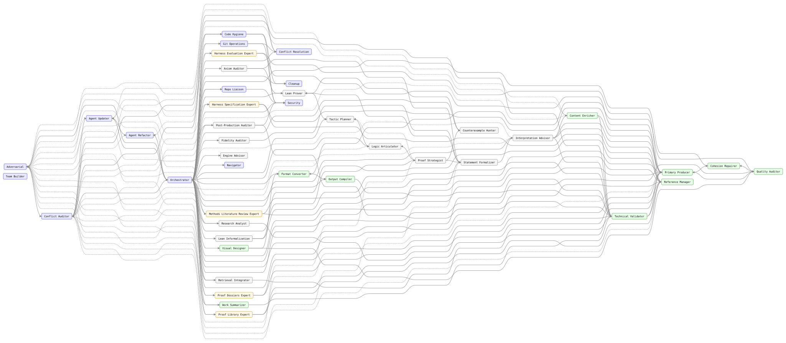
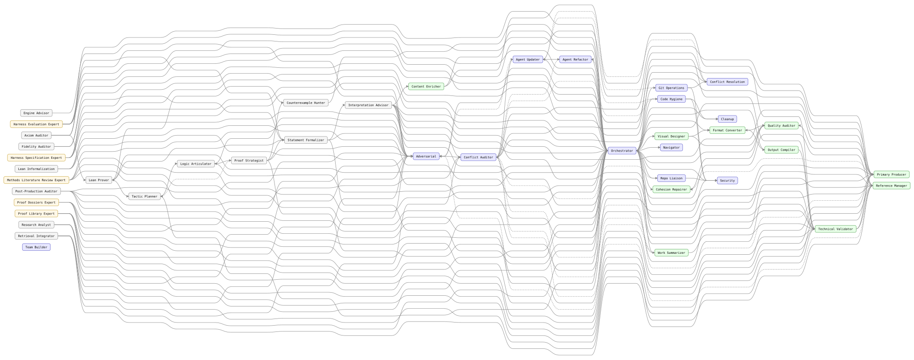

<!-- AGENTTEAMS:BEGIN content v=1 -->
# mathAgents — Agent Team Topology

> **Auto-generated.** Regenerated on every `build_team.py` run.
> Do not edit manually — changes will be overwritten.

---

## Team Topology Graph



The handoff-only control-flow backbone (agents-list edges omitted):



---

## Node Legend

| Colour | Agent Type |
| --- | --- |
| <svg width="12" height="12"><rect width="12" height="12" fill="#e8e8ff" stroke="#6666cc"/></svg> Blue-lavender | Governance |
| <svg width="12" height="12"><rect width="12" height="12" fill="#e8ffe8" stroke="#66aa66"/></svg> Green | Domain |
| <svg width="12" height="12"><rect width="12" height="12" fill="#fff8e8" stroke="#ccaa44"/></svg> Yellow | Workstream Expert |
| <svg width="12" height="12"><rect width="12" height="12" fill="#ffe8e8" stroke="#cc6666"/></svg> Red-pink | Tool Specialist |

---

## Agent Roster

| Agent | Type | User-Invokable | Tools |
| --- | --- | --- | --- |
| `adversarial` | governance | Yes | read, search |
| `agent-refactor` | governance | No | edit, search, agent |
| `agent-updater` | governance | No | edit, search, execute, agent |
| `axiom-auditor` | unknown | No | read, search, execute |
| `cleanup` | governance | No | edit, search, execute |
| `code-hygiene` | governance | No | read, search |
| `cohesion-repairer` | domain | No | read, edit |
| `conflict-auditor` | governance | No | read, search |
| `conflict-resolution` | governance | No | edit, search, read |
| `content-enricher` | domain | Yes | read, edit, search |
| `counterexample-hunter` | unknown | No | read, search, execute |
| `engine-advisor` | unknown | No | read, search |
| `evaluation-expert` | workstream_expert | No | read, search, agent |
| `fidelity-auditor` | unknown | No | read, search |
| `format-converter` | domain | No | read, edit, execute |
| `git-operations` | governance | Yes | read, execute, search |
| `harness-spec-expert` | workstream_expert | No | read, search, agent |
| `interpretation-advisor` | unknown | No | read, search, agent |
| `lean-informalization` | unknown | No | read, search |
| `lean-prover` | unknown | No | read, search, execute |
| `logic-articulator` | unknown | No | read, search |
| `methods-review-expert` | workstream_expert | No | read, search, agent |
| `navigator` | governance | No | read, search, execute |
| `orchestrator` | governance | Yes | read, edit, search, execute, todo, agent |
| `output-compiler` | domain | No | read, edit, execute |
| `post-production-auditor` | unknown | No | read, search, execute |
| `primary-producer` | domain | No | read, edit, search |
| `proof-dossiers-expert` | workstream_expert | No | read, search, agent |
| `proof-library-expert` | workstream_expert | No | read, search, agent |
| `proof-strategist` | unknown | No | read, search |
| `quality-auditor` | domain | No | read, search |
| `reference-manager` | domain | No | read, edit, search, retrieval |
| `repo-liaison` | governance | No | read, edit, search, execute, agent |
| `research-analyst` | unknown | Yes | read, edit, search, execute |
| `retrieval-integrator` | unknown | No | read, search, execute |
| `security` | governance | No | read, search |
| `statement-formalizer` | unknown | No | read, search, execute |
| `tactic-planner` | unknown | No | read, search |
| `team-builder` | governance | Yes | read, edit, search, execute, todo |
| `technical-validator` | domain | No | read, search |
| `visual-designer` | domain | No | read, edit, execute, search |
| `work-summarizer` | domain | Yes | read, search, execute, edit, agent |

---

## Adjacency List

| Agent | Receives from | Hands off to |
| --- | --- | --- |
| `adversarial` | `agent-updater`, `content-enricher`, `evaluation-expert`, `harness-spec-expert`, `interpretation-advisor`, `logic-articulator`, `methods-review-expert`, `orchestrator`, `post-production-auditor`, `proof-dossiers-expert`, `proof-library-expert`, `proof-strategist`, `research-analyst`, `retrieval-integrator`, `statement-formalizer`, `work-summarizer` | `conflict-auditor`, `orchestrator` |
| `agent-refactor` | `agent-updater`, `code-hygiene`, `orchestrator` | `conflict-auditor`, `orchestrator` |
| `agent-updater` | `conflict-auditor`, `conflict-resolution`, `git-operations`, `orchestrator` | `adversarial`, `agent-refactor`, `conflict-auditor`, `orchestrator` |
| `axiom-auditor` | `orchestrator` | `lean-prover`, `orchestrator`, `statement-formalizer` |
| `cleanup` | `code-hygiene`, `orchestrator` | `orchestrator` |
| `code-hygiene` | `orchestrator` | `agent-refactor`, `cleanup`, `conflict-auditor`, `orchestrator`, `security` |
| `cohesion-repairer` | `orchestrator`, `primary-producer`, `quality-auditor` | `orchestrator`, `quality-auditor` |
| `conflict-auditor` | `adversarial`, `agent-refactor`, `agent-updater`, `code-hygiene`, `content-enricher`, `interpretation-advisor`, `orchestrator`, `post-production-auditor`, `primary-producer`, `reference-manager`, `repo-liaison`, `research-analyst`, `retrieval-integrator`, `technical-validator`, `work-summarizer` | `agent-updater`, `conflict-resolution`, `orchestrator`, `technical-validator` |
| `conflict-resolution` | `conflict-auditor`, `git-operations`, `orchestrator` | `agent-updater`, `orchestrator` |
| `content-enricher` | `interpretation-advisor` | `adversarial`, `conflict-auditor`, `orchestrator`, `primary-producer`, `technical-validator` |
| `counterexample-hunter` | `lean-prover`, `orchestrator`, `proof-strategist` | `lean-prover`, `orchestrator` |
| `engine-advisor` | `orchestrator` | `orchestrator` |
| `evaluation-expert` | `orchestrator` | `adversarial`, `orchestrator`, `primary-producer`, `reference-manager` |
| `fidelity-auditor` | `orchestrator` | `orchestrator`, `statement-formalizer` |
| `format-converter` | `orchestrator`, `output-compiler`, `visual-designer` | `orchestrator`, `output-compiler`, `quality-auditor` |
| `git-operations` | `orchestrator` | `agent-updater`, `conflict-resolution`, `orchestrator`, `security` |
| `harness-spec-expert` | `orchestrator` | `adversarial`, `orchestrator`, `primary-producer`, `reference-manager` |
| `interpretation-advisor` | `orchestrator`, `statement-formalizer` | `adversarial`, `conflict-auditor`, `content-enricher`, `orchestrator`, `primary-producer`, `reference-manager`, `technical-validator` |
| `lean-informalization` | `orchestrator` | `orchestrator`, `reference-manager`, `technical-validator` |
| `lean-prover` | `axiom-auditor`, `counterexample-hunter`, `orchestrator`, `tactic-planner` | `counterexample-hunter`, `orchestrator`, `statement-formalizer`, `tactic-planner` |
| `logic-articulator` | `orchestrator`, `proof-strategist`, `tactic-planner` | `adversarial`, `orchestrator`, `proof-strategist`, `tactic-planner` |
| `methods-review-expert` | `orchestrator` | `adversarial`, `orchestrator`, `primary-producer`, `reference-manager` |
| `navigator` | `orchestrator` | `orchestrator` |
| `orchestrator` | `adversarial`, `agent-refactor`, `agent-updater`, `axiom-auditor`, `cleanup`, `code-hygiene`, `cohesion-repairer`, `conflict-auditor`, `conflict-resolution`, `content-enricher`, `counterexample-hunter`, `engine-advisor`, `evaluation-expert`, `fidelity-auditor`, `format-converter`, `git-operations`, `harness-spec-expert`, `interpretation-advisor`, `lean-informalization`, `lean-prover`, `logic-articulator`, `methods-review-expert`, `navigator`, `output-compiler`, `post-production-auditor`, `primary-producer`, `proof-dossiers-expert`, `proof-library-expert`, `proof-strategist`, `quality-auditor`, `reference-manager`, `repo-liaison`, `research-analyst`, `retrieval-integrator`, `security`, `statement-formalizer`, `tactic-planner`, `technical-validator`, `visual-designer`, `work-summarizer` | `adversarial`, `agent-refactor`, `agent-updater`, `axiom-auditor`, `cleanup`, `code-hygiene`, `cohesion-repairer`, `conflict-auditor`, `conflict-resolution`, `counterexample-hunter`, `engine-advisor`, `evaluation-expert`, `fidelity-auditor`, `format-converter`, `git-operations`, `harness-spec-expert`, `interpretation-advisor`, `lean-informalization`, `lean-prover`, `logic-articulator`, `methods-review-expert`, `navigator`, `output-compiler`, `post-production-auditor`, `primary-producer`, `proof-dossiers-expert`, `proof-library-expert`, `proof-strategist`, `quality-auditor`, `reference-manager`, `repo-liaison`, `research-analyst`, `retrieval-integrator`, `security`, `statement-formalizer`, `tactic-planner`, `technical-validator`, `visual-designer`, `work-summarizer` |
| `output-compiler` | `format-converter`, `orchestrator` | `format-converter`, `orchestrator`, `technical-validator` |
| `post-production-auditor` | `orchestrator` | `adversarial`, `conflict-auditor`, `orchestrator`, `security`, `technical-validator` |
| `primary-producer` | `content-enricher`, `evaluation-expert`, `harness-spec-expert`, `interpretation-advisor`, `methods-review-expert`, `orchestrator`, `proof-dossiers-expert`, `proof-library-expert`, `quality-auditor`, `technical-validator` | `cohesion-repairer`, `conflict-auditor`, `orchestrator`, `quality-auditor` |
| `proof-dossiers-expert` | `orchestrator` | `adversarial`, `orchestrator`, `primary-producer`, `reference-manager` |
| `proof-library-expert` | `orchestrator` | `adversarial`, `orchestrator`, `primary-producer`, `reference-manager` |
| `proof-strategist` | `logic-articulator`, `orchestrator` | `adversarial`, `counterexample-hunter`, `logic-articulator`, `orchestrator`, `statement-formalizer`, `tactic-planner` |
| `quality-auditor` | `cohesion-repairer`, `format-converter`, `orchestrator`, `primary-producer`, `visual-designer` | `cohesion-repairer`, `orchestrator`, `primary-producer` |
| `reference-manager` | `evaluation-expert`, `harness-spec-expert`, `interpretation-advisor`, `lean-informalization`, `methods-review-expert`, `orchestrator`, `proof-dossiers-expert`, `proof-library-expert`, `technical-validator` | `conflict-auditor`, `orchestrator` |
| `repo-liaison` | `orchestrator` | `conflict-auditor`, `orchestrator`, `security` |
| `research-analyst` | `orchestrator` | `adversarial`, `conflict-auditor`, `orchestrator`, `technical-validator` |
| `retrieval-integrator` | `orchestrator` | `adversarial`, `conflict-auditor`, `orchestrator`, `technical-validator` |
| `security` | `code-hygiene`, `git-operations`, `orchestrator`, `post-production-auditor`, `repo-liaison` | `orchestrator` |
| `statement-formalizer` | `axiom-auditor`, `fidelity-auditor`, `lean-prover`, `orchestrator`, `proof-strategist` | `adversarial`, `interpretation-advisor`, `orchestrator` |
| `tactic-planner` | `lean-prover`, `logic-articulator`, `orchestrator`, `proof-strategist` | `lean-prover`, `logic-articulator`, `orchestrator` |
| `team-builder` | — | — |
| `technical-validator` | `conflict-auditor`, `content-enricher`, `interpretation-advisor`, `lean-informalization`, `orchestrator`, `output-compiler`, `post-production-auditor`, `research-analyst`, `retrieval-integrator`, `work-summarizer` | `conflict-auditor`, `orchestrator`, `primary-producer`, `reference-manager` |
| `visual-designer` | `orchestrator` | `format-converter`, `orchestrator`, `quality-auditor` |
| `work-summarizer` | `orchestrator` | `adversarial`, `conflict-auditor`, `orchestrator`, `technical-validator` |

---

## Diagram Source

<details>
<summary>Mermaid &amp; DOT source for the topology diagram above</summary>

```mermaid
flowchart LR
    classDef governance fill:#e8e8ff,stroke:#6666cc,color:#000
    classDef domain    fill:#e8ffe8,stroke:#66aa66,color:#000
    classDef workstream_expert fill:#fff8e8,stroke:#ccaa44,color:#000
    classDef tool_specialist   fill:#ffe8e8,stroke:#cc6666,color:#000
    classDef unknown   fill:#f5f5f5,stroke:#999,color:#000
    adversarial["Adversarial"]
    class adversarial governance
    agent_refactor["Agent Refactor"]
    class agent_refactor governance
    agent_updater["Agent Updater"]
    class agent_updater governance
    axiom_auditor["Axiom Auditor"]
    class axiom_auditor unknown
    cleanup["Cleanup"]
    class cleanup governance
    code_hygiene["Code Hygiene"]
    class code_hygiene governance
    cohesion_repairer["Cohesion Repairer"]
    class cohesion_repairer domain
    conflict_auditor["Conflict Auditor"]
    class conflict_auditor governance
    conflict_resolution["Conflict Resolution"]
    class conflict_resolution governance
    content_enricher["Content Enricher"]
    class content_enricher domain
    counterexample_hunter["Counterexample Hunter"]
    class counterexample_hunter unknown
    engine_advisor["Engine Advisor"]
    class engine_advisor unknown
    evaluation_expert["Harness Evaluation Expert"]
    class evaluation_expert workstream_expert
    fidelity_auditor["Fidelity Auditor"]
    class fidelity_auditor unknown
    format_converter["Format Converter"]
    class format_converter domain
    git_operations["Git Operations"]
    class git_operations governance
    harness_spec_expert["Harness Specification Expert"]
    class harness_spec_expert workstream_expert
    interpretation_advisor["Interpretation Advisor"]
    class interpretation_advisor unknown
    lean_informalization["Lean Informalization"]
    class lean_informalization unknown
    lean_prover["Lean Prover"]
    class lean_prover unknown
    logic_articulator["Logic Articulator"]
    class logic_articulator unknown
    methods_review_expert["Methods Literature Review Expert"]
    class methods_review_expert workstream_expert
    navigator["Navigator"]
    class navigator governance
    orchestrator["Orchestrator"]
    class orchestrator governance
    output_compiler["Output Compiler"]
    class output_compiler domain
    post_production_auditor["Post-Production Auditor"]
    class post_production_auditor unknown
    primary_producer["Primary Producer"]
    class primary_producer domain
    proof_dossiers_expert["Proof Dossiers Expert"]
    class proof_dossiers_expert workstream_expert
    proof_library_expert["Proof Library Expert"]
    class proof_library_expert workstream_expert
    proof_strategist["Proof Strategist"]
    class proof_strategist unknown
    quality_auditor["Quality Auditor"]
    class quality_auditor domain
    reference_manager["Reference Manager"]
    class reference_manager domain
    repo_liaison["Repo Liaison"]
    class repo_liaison governance
    research_analyst["Research Analyst"]
    class research_analyst unknown
    retrieval_integrator["Retrieval Integrator"]
    class retrieval_integrator unknown
    security["Security"]
    class security governance
    statement_formalizer["Statement Formalizer"]
    class statement_formalizer unknown
    tactic_planner["Tactic Planner"]
    class tactic_planner unknown
    team_builder["Team Builder"]
    class team_builder governance
    technical_validator["Technical Validator"]
    class technical_validator domain
    visual_designer["Visual Designer"]
    class visual_designer domain
    work_summarizer["Work Summarizer"]
    class work_summarizer domain
    adversarial -->|"Audit for Conflicts"| conflict_auditor
    adversarial -->|"Return to Orchestrator"| orchestrator
    agent_refactor -->|"Run Conflict Audit"| conflict_auditor
    agent_refactor -->|"Return to Orchestrator"| orchestrator
    agent_refactor -.-> conflict_auditor
    agent_updater -->|"Run Adversarial Review"| adversarial
    agent_updater -->|"Refactor Agent Docs"| agent_refactor
    agent_updater -->|"Run Conflict Audit"| conflict_auditor
    agent_updater -->|"Return to Orchestrator"| orchestrator
    agent_updater -.-> adversarial
    agent_updater -.-> agent_refactor
    agent_updater -.-> conflict_auditor
    axiom_auditor -->|"Kernel Findings to the Prover"| lean_prover
    axiom_auditor -->|"Return to Orchestrator"| orchestrator
    axiom_auditor -->|"Statement Findings to the Formalizer"| statement_formalizer
    axiom_auditor -.-> lean_prover
    axiom_auditor -.-> orchestrator
    axiom_auditor -.-> statement_formalizer
    cleanup -->|"Return to Orchestrator"| orchestrator
    code_hygiene -->|"Agent Refactor (Structural Violations)"| agent_refactor
    code_hygiene -->|"Cleanup Agent"| cleanup
    code_hygiene -->|"Log Conflict"| conflict_auditor
    code_hygiene -->|"Return to Orchestrator"| orchestrator
    code_hygiene -->|"Security Clearance (for Deletions)"| security
    cohesion_repairer -->|"Return to Orchestrator"| orchestrator
    cohesion_repairer -->|"Quality Re-Check"| quality_auditor
    cohesion_repairer -.-> quality_auditor
    conflict_auditor -->|"Update Agent Docs"| agent_updater
    conflict_auditor -->|"Resolve Conflicts"| conflict_resolution
    conflict_auditor -->|"Return to Orchestrator"| orchestrator
    conflict_auditor -->|"Verify Source Drift"| technical_validator
    conflict_auditor -.-> agent_updater
    conflict_auditor -.-> conflict_resolution
    conflict_auditor -.-> technical_validator
    conflict_resolution -->|"Update Agent Docs"| agent_updater
    conflict_resolution -->|"Return to Orchestrator"| orchestrator
    content_enricher -->|"Return to Orchestrator"| orchestrator
    content_enricher -->|"Validate Enriched Content"| technical_validator
    content_enricher -.-> adversarial
    content_enricher -.-> conflict_auditor
    content_enricher -.-> primary_producer
    content_enricher -.-> technical_validator
    counterexample_hunter -->|"Request a Lean Witness"| lean_prover
    counterexample_hunter -->|"Return to Orchestrator for G-CX"| orchestrator
    counterexample_hunter -.-> lean_prover
    counterexample_hunter -.-> orchestrator
    engine_advisor -->|"Return to Orchestrator"| orchestrator
    evaluation_expert -->|"Vet Brief Before Drafting"| adversarial
    evaluation_expert -->|"Return to Orchestrator"| orchestrator
    evaluation_expert -->|"Send to Primary Producer"| primary_producer
    evaluation_expert -->|"Verify Citations"| reference_manager
    evaluation_expert -.-> adversarial
    evaluation_expert -.-> primary_producer
    evaluation_expert -.-> reference_manager
    fidelity_auditor -->|"Return to Orchestrator"| orchestrator
    fidelity_auditor -->|"Report Drift to Drafter"| statement_formalizer
    fidelity_auditor -.-> orchestrator
    fidelity_auditor -.-> statement_formalizer
    format_converter -->|"Return to Orchestrator"| orchestrator
    format_converter -->|"Pass to Output Compiler"| output_compiler
    format_converter -->|"Quality Check After Conversion"| quality_auditor
    format_converter -.-> output_compiler
    format_converter -.-> quality_auditor
    git_operations -->|"Update Agent Docs"| agent_updater
    git_operations -->|"Conflict Resolution"| conflict_resolution
    git_operations -->|"Return to Orchestrator"| orchestrator
    git_operations -->|"Security Review"| security
    harness_spec_expert -->|"Vet Brief Before Drafting"| adversarial
    harness_spec_expert -->|"Return to Orchestrator"| orchestrator
    harness_spec_expert -->|"Send to Primary Producer"| primary_producer
    harness_spec_expert -->|"Verify Citations"| reference_manager
    harness_spec_expert -.-> adversarial
    harness_spec_expert -.-> primary_producer
    harness_spec_expert -.-> reference_manager
    interpretation_advisor -->|"Audit Reading Presuppositions"| adversarial
    interpretation_advisor -->|"Audit Interpretive Conflicts"| conflict_auditor
    interpretation_advisor -->|"Commission Logic or Method Guide"| content_enricher
    interpretation_advisor -->|"Return to Orchestrator"| orchestrator
    interpretation_advisor -->|"Commission Interpretation Brief"| primary_producer
    interpretation_advisor -->|"Verify Citation Existence"| reference_manager
    interpretation_advisor -->|"Build Attribution Claim Ledger"| technical_validator
    interpretation_advisor -.-> adversarial
    interpretation_advisor -.-> conflict_auditor
    interpretation_advisor -.-> content_enricher
    interpretation_advisor -.-> orchestrator
    interpretation_advisor -.-> primary_producer
    interpretation_advisor -.-> reference_manager
    interpretation_advisor -.-> technical_validator
    lean_informalization -->|"Return to Orchestrator"| orchestrator
    lean_informalization -->|"Verify / add external citations"| reference_manager
    lean_informalization -->|"Verify narration against the code"| technical_validator
    lean_prover -->|"Suspect a Counterexample"| counterexample_hunter
    lean_prover -->|"Return to Orchestrator"| orchestrator
    lean_prover -->|"Statement Looks Wrong"| statement_formalizer
    lean_prover -->|"Ask for a New Plan"| tactic_planner
    lean_prover -.-> counterexample_hunter
    lean_prover -.-> orchestrator
    lean_prover -.-> statement_formalizer
    lean_prover -.-> tactic_planner
    logic_articulator -->|"Audit Derivations"| adversarial
    logic_articulator -->|"Return to Orchestrator"| orchestrator
    logic_articulator -->|"Report a Strategy Gap"| proof_strategist
    logic_articulator -->|"Hand to Tactic Planning"| tactic_planner
    logic_articulator -.-> adversarial
    logic_articulator -.-> orchestrator
    logic_articulator -.-> proof_strategist
    logic_articulator -.-> tactic_planner
    methods_review_expert -->|"Vet Brief Before Drafting"| adversarial
    methods_review_expert -->|"Return to Orchestrator"| orchestrator
    methods_review_expert -->|"Send to Primary Producer"| primary_producer
    methods_review_expert -->|"Verify Citations"| reference_manager
    methods_review_expert -.-> adversarial
    methods_review_expert -.-> primary_producer
    methods_review_expert -.-> reference_manager
    navigator -->|"Return to Orchestrator"| orchestrator
    orchestrator -->|"Adversarial Review"| adversarial
    orchestrator -->|"Refactor Agent Docs"| agent_refactor
    orchestrator -->|"Update Agent Docs"| agent_updater
    orchestrator -->|"Clean Up Artifacts"| cleanup
    orchestrator -->|"Code Hygiene Audit"| code_hygiene
    orchestrator -->|"Repair Cohesion"| cohesion_repairer
    orchestrator -->|"Conflict Audit"| conflict_auditor
    orchestrator -->|"Resolve Conflicts"| conflict_resolution
    orchestrator -->|"Convert / Transform Output"| format_converter
    orchestrator -->|"Git Operations"| git_operations
    orchestrator -->|"Navigate Project"| navigator
    orchestrator -->|"Compile Final Output"| output_compiler
    orchestrator -->|"Produce / Revise Deliverable"| primary_producer
    orchestrator -->|"Audit Quality"| quality_auditor
    orchestrator -->|"Manage References / Dependencies"| reference_manager
    orchestrator -->|"Cross-Repository Liaison"| repo_liaison
    orchestrator -->|"Security Review"| security
    orchestrator -->|"Validate Technical Accuracy"| technical_validator
    orchestrator -->|"Generate / Revise Diagram"| visual_designer
    orchestrator -->|"Summarize Work Period"| work_summarizer
    orchestrator -.-> adversarial
    orchestrator -.-> agent_refactor
    orchestrator -.-> agent_updater
    orchestrator -.-> axiom_auditor
    orchestrator -.-> cleanup
    orchestrator -.-> code_hygiene
    orchestrator -.-> cohesion_repairer
    orchestrator -.-> conflict_auditor
    orchestrator -.-> conflict_resolution
    orchestrator -.-> counterexample_hunter
    orchestrator -.-> engine_advisor
    orchestrator -.-> evaluation_expert
    orchestrator -.-> fidelity_auditor
    orchestrator -.-> format_converter
    orchestrator -.-> git_operations
    orchestrator -.-> harness_spec_expert
    orchestrator -.-> interpretation_advisor
    orchestrator -.-> lean_informalization
    orchestrator -.-> lean_prover
    orchestrator -.-> logic_articulator
    orchestrator -.-> methods_review_expert
    orchestrator -.-> navigator
    orchestrator -.-> output_compiler
    orchestrator -.-> post_production_auditor
    orchestrator -.-> primary_producer
    orchestrator -.-> proof_dossiers_expert
    orchestrator -.-> proof_library_expert
    orchestrator -.-> proof_strategist
    orchestrator -.-> quality_auditor
    orchestrator -.-> reference_manager
    orchestrator -.-> repo_liaison
    orchestrator -.-> research_analyst
    orchestrator -.-> retrieval_integrator
    orchestrator -.-> security
    orchestrator -.-> statement_formalizer
    orchestrator -.-> tactic_planner
    orchestrator -.-> technical_validator
    orchestrator -.-> visual_designer
    orchestrator -.-> work_summarizer
    output_compiler -->|"Convert Missing Components"| format_converter
    output_compiler -->|"Return to Orchestrator"| orchestrator
    output_compiler -->|"Validate Technical Accuracy"| technical_validator
    output_compiler -.-> format_converter
    output_compiler -.-> technical_validator
    post_production_auditor -->|"Adversarial Review"| adversarial
    post_production_auditor -->|"Conflict Audit"| conflict_auditor
    post_production_auditor -->|"Return to Orchestrator"| orchestrator
    post_production_auditor -->|"Security Review"| security
    post_production_auditor -->|"Technical Validation"| technical_validator
    post_production_auditor -.-> adversarial
    post_production_auditor -.-> conflict_auditor
    post_production_auditor -.-> orchestrator
    post_production_auditor -.-> security
    post_production_auditor -.-> technical_validator
    primary_producer -->|"Cohesion Audit"| cohesion_repairer
    primary_producer -->|"Conflict Audit"| conflict_auditor
    primary_producer -->|"Return to Orchestrator"| orchestrator
    primary_producer -->|"Quality Audit"| quality_auditor
    primary_producer -.-> cohesion_repairer
    primary_producer -.-> conflict_auditor
    primary_producer -.-> quality_auditor
    proof_dossiers_expert -->|"Vet Brief Before Drafting"| adversarial
    proof_dossiers_expert -->|"Return to Orchestrator"| orchestrator
    proof_dossiers_expert -->|"Send to Primary Producer"| primary_producer
    proof_dossiers_expert -->|"Verify Citations"| reference_manager
    proof_dossiers_expert -.-> adversarial
    proof_dossiers_expert -.-> primary_producer
    proof_dossiers_expert -.-> reference_manager
    proof_library_expert -->|"Vet Brief Before Drafting"| adversarial
    proof_library_expert -->|"Return to Orchestrator"| orchestrator
    proof_library_expert -->|"Send to Primary Producer"| primary_producer
    proof_library_expert -->|"Verify Citations"| reference_manager
    proof_library_expert -.-> adversarial
    proof_library_expert -.-> primary_producer
    proof_library_expert -.-> reference_manager
    proof_strategist -->|"Adversarial Strategy Review"| adversarial
    proof_strategist -->|"Probe for Counterexamples"| counterexample_hunter
    proof_strategist -->|"Derive the Logical Spine"| logic_articulator
    proof_strategist -->|"Return to Orchestrator"| orchestrator
    proof_strategist -->|"Loop Back to Stage 1"| statement_formalizer
    proof_strategist -->|"Plan Tactics"| tactic_planner
    proof_strategist -.-> adversarial
    proof_strategist -.-> counterexample_hunter
    proof_strategist -.-> logic_articulator
    proof_strategist -.-> orchestrator
    proof_strategist -.-> statement_formalizer
    proof_strategist -.-> tactic_planner
    quality_auditor -->|"Route Cohesion Failures"| cohesion_repairer
    quality_auditor -->|"Return to Orchestrator"| orchestrator
    quality_auditor -->|"Route Corrections to Primary Producer"| primary_producer
    quality_auditor -.-> cohesion_repairer
    quality_auditor -.-> primary_producer
    reference_manager -->|"Run Conflict Audit"| conflict_auditor
    reference_manager -->|"Return to Orchestrator"| orchestrator
    reference_manager -.-> conflict_auditor
    repo_liaison -->|"Conflict Audit After Cross-Repo Change"| conflict_auditor
    repo_liaison -->|"Return to Orchestrator"| orchestrator
    repo_liaison -->|"Security Review for Cross-Repo Write"| security
    research_analyst -->|"Adversarial Review"| adversarial
    research_analyst -->|"Return to Orchestrator"| orchestrator
    research_analyst -->|"Technical Validation"| technical_validator
    research_analyst -.-> adversarial
    research_analyst -.-> conflict_auditor
    research_analyst -.-> technical_validator
    retrieval_integrator -->|"Adversarial Review"| adversarial
    retrieval_integrator -->|"Conflict Audit"| conflict_auditor
    retrieval_integrator -->|"Return to Orchestrator"| orchestrator
    retrieval_integrator -->|"Technical Validation"| technical_validator
    retrieval_integrator -.-> adversarial
    retrieval_integrator -.-> conflict_auditor
    retrieval_integrator -.-> technical_validator
    security -->|"Return to Orchestrator"| orchestrator
    statement_formalizer -->|"Audit Hidden Hypotheses"| adversarial
    statement_formalizer -->|"Ask for Readings"| interpretation_advisor
    statement_formalizer -->|"Return to Orchestrator for G-FID"| orchestrator
    statement_formalizer -.-> adversarial
    statement_formalizer -.-> interpretation_advisor
    statement_formalizer -.-> orchestrator
    tactic_planner -->|"Hand to Lean Prover"| lean_prover
    tactic_planner -->|"Ask for a Derivation"| logic_articulator
    tactic_planner -->|"Return to Orchestrator"| orchestrator
    tactic_planner -.-> lean_prover
    tactic_planner -.-> logic_articulator
    tactic_planner -.-> orchestrator
    technical_validator -->|"Log Conflict"| conflict_auditor
    technical_validator -->|"Return to Orchestrator"| orchestrator
    technical_validator -->|"Route Corrections to Primary Producer"| primary_producer
    technical_validator -->|"Route Reference Issues"| reference_manager
    technical_validator -.-> conflict_auditor
    technical_validator -.-> primary_producer
    technical_validator -.-> reference_manager
    visual_designer -->|"Convert Figure Format"| format_converter
    visual_designer -->|"Return to Orchestrator"| orchestrator
    visual_designer -->|"Quality Check Figure"| quality_auditor
    visual_designer -.-> format_converter
    visual_designer -.-> quality_auditor
    work_summarizer -->|"Run Adversarial Audit"| adversarial
    work_summarizer -->|"Run Conflict Audit"| conflict_auditor
    work_summarizer -->|"Return to Orchestrator"| orchestrator
    work_summarizer -->|"Verify Summary Accuracy"| technical_validator
    work_summarizer -.-> adversarial
    work_summarizer -.-> conflict_auditor
    work_summarizer -.-> technical_validator
```

```dot
digraph "mathAgents Agent Team" {
    rankdir=LR;
    node [fontname="Helvetica", fontsize=11, shape=box, style="rounded,filled"];
    edge [fontsize=9];
    "adversarial" [label="Adversarial", fillcolor="#e8e8ff"];
    "agent-refactor" [label="Agent Refactor", fillcolor="#e8e8ff"];
    "agent-updater" [label="Agent Updater", fillcolor="#e8e8ff"];
    "axiom-auditor" [label="Axiom Auditor", fillcolor="#f5f5f5"];
    "cleanup" [label="Cleanup", fillcolor="#e8e8ff"];
    "code-hygiene" [label="Code Hygiene", fillcolor="#e8e8ff"];
    "cohesion-repairer" [label="Cohesion Repairer", fillcolor="#e8ffe8"];
    "conflict-auditor" [label="Conflict Auditor", fillcolor="#e8e8ff"];
    "conflict-resolution" [label="Conflict Resolution", fillcolor="#e8e8ff"];
    "content-enricher" [label="Content Enricher", fillcolor="#e8ffe8"];
    "counterexample-hunter" [label="Counterexample Hunter", fillcolor="#f5f5f5"];
    "engine-advisor" [label="Engine Advisor", fillcolor="#f5f5f5"];
    "evaluation-expert" [label="Harness Evaluation Expert", fillcolor="#fff8e8"];
    "fidelity-auditor" [label="Fidelity Auditor", fillcolor="#f5f5f5"];
    "format-converter" [label="Format Converter", fillcolor="#e8ffe8"];
    "git-operations" [label="Git Operations", fillcolor="#e8e8ff"];
    "harness-spec-expert" [label="Harness Specification Expert", fillcolor="#fff8e8"];
    "interpretation-advisor" [label="Interpretation Advisor", fillcolor="#f5f5f5"];
    "lean-informalization" [label="Lean Informalization", fillcolor="#f5f5f5"];
    "lean-prover" [label="Lean Prover", fillcolor="#f5f5f5"];
    "logic-articulator" [label="Logic Articulator", fillcolor="#f5f5f5"];
    "methods-review-expert" [label="Methods Literature Review Expert", fillcolor="#fff8e8"];
    "navigator" [label="Navigator", fillcolor="#e8e8ff"];
    "orchestrator" [label="Orchestrator", fillcolor="#e8e8ff"];
    "output-compiler" [label="Output Compiler", fillcolor="#e8ffe8"];
    "post-production-auditor" [label="Post-Production Auditor", fillcolor="#f5f5f5"];
    "primary-producer" [label="Primary Producer", fillcolor="#e8ffe8"];
    "proof-dossiers-expert" [label="Proof Dossiers Expert", fillcolor="#fff8e8"];
    "proof-library-expert" [label="Proof Library Expert", fillcolor="#fff8e8"];
    "proof-strategist" [label="Proof Strategist", fillcolor="#f5f5f5"];
    "quality-auditor" [label="Quality Auditor", fillcolor="#e8ffe8"];
    "reference-manager" [label="Reference Manager", fillcolor="#e8ffe8"];
    "repo-liaison" [label="Repo Liaison", fillcolor="#e8e8ff"];
    "research-analyst" [label="Research Analyst", fillcolor="#f5f5f5"];
    "retrieval-integrator" [label="Retrieval Integrator", fillcolor="#f5f5f5"];
    "security" [label="Security", fillcolor="#e8e8ff"];
    "statement-formalizer" [label="Statement Formalizer", fillcolor="#f5f5f5"];
    "tactic-planner" [label="Tactic Planner", fillcolor="#f5f5f5"];
    "team-builder" [label="Team Builder", fillcolor="#e8e8ff"];
    "technical-validator" [label="Technical Validator", fillcolor="#e8ffe8"];
    "visual-designer" [label="Visual Designer", fillcolor="#e8ffe8"];
    "work-summarizer" [label="Work Summarizer", fillcolor="#e8ffe8"];
    "adversarial" -> "conflict-auditor" [style=solid, label="Audit for Conflicts"];
    "adversarial" -> "orchestrator" [style=solid, label="Return to Orchestrator"];
    "agent-refactor" -> "conflict-auditor" [style=solid, label="Run Conflict Audit"];
    "agent-refactor" -> "orchestrator" [style=solid, label="Return to Orchestrator"];
    "agent-updater" -> "adversarial" [style=solid, label="Run Adversarial Review"];
    "agent-updater" -> "agent-refactor" [style=solid, label="Refactor Agent Docs"];
    "agent-updater" -> "conflict-auditor" [style=solid, label="Run Conflict Audit"];
    "agent-updater" -> "orchestrator" [style=solid, label="Return to Orchestrator"];
    "axiom-auditor" -> "lean-prover" [style=solid, label="Kernel Findings to the Prover"];
    "axiom-auditor" -> "orchestrator" [style=solid, label="Return to Orchestrator"];
    "axiom-auditor" -> "statement-formalizer" [style=solid, label="Statement Findings to the Formalizer"];
    "cleanup" -> "orchestrator" [style=solid, label="Return to Orchestrator"];
    "code-hygiene" -> "agent-refactor" [style=solid, label="Agent Refactor (Structural Violations)"];
    "code-hygiene" -> "cleanup" [style=solid, label="Cleanup Agent"];
    "code-hygiene" -> "conflict-auditor" [style=solid, label="Log Conflict"];
    "code-hygiene" -> "orchestrator" [style=solid, label="Return to Orchestrator"];
    "code-hygiene" -> "security" [style=solid, label="Security Clearance (for Deletions)"];
    "cohesion-repairer" -> "orchestrator" [style=solid, label="Return to Orchestrator"];
    "cohesion-repairer" -> "quality-auditor" [style=solid, label="Quality Re-Check"];
    "conflict-auditor" -> "agent-updater" [style=solid, label="Update Agent Docs"];
    "conflict-auditor" -> "conflict-resolution" [style=solid, label="Resolve Conflicts"];
    "conflict-auditor" -> "orchestrator" [style=solid, label="Return to Orchestrator"];
    "conflict-auditor" -> "technical-validator" [style=solid, label="Verify Source Drift"];
    "conflict-resolution" -> "agent-updater" [style=solid, label="Update Agent Docs"];
    "conflict-resolution" -> "orchestrator" [style=solid, label="Return to Orchestrator"];
    "content-enricher" -> "orchestrator" [style=solid, label="Return to Orchestrator"];
    "content-enricher" -> "technical-validator" [style=solid, label="Validate Enriched Content"];
    "content-enricher" -> "adversarial" [style=dashed];
    "content-enricher" -> "conflict-auditor" [style=dashed];
    "content-enricher" -> "primary-producer" [style=dashed];
    "counterexample-hunter" -> "lean-prover" [style=solid, label="Request a Lean Witness"];
    "counterexample-hunter" -> "orchestrator" [style=solid, label="Return to Orchestrator for G-CX"];
    "engine-advisor" -> "orchestrator" [style=solid, label="Return to Orchestrator"];
    "evaluation-expert" -> "adversarial" [style=solid, label="Vet Brief Before Drafting"];
    "evaluation-expert" -> "orchestrator" [style=solid, label="Return to Orchestrator"];
    "evaluation-expert" -> "primary-producer" [style=solid, label="Send to Primary Producer"];
    "evaluation-expert" -> "reference-manager" [style=solid, label="Verify Citations"];
    "fidelity-auditor" -> "orchestrator" [style=solid, label="Return to Orchestrator"];
    "fidelity-auditor" -> "statement-formalizer" [style=solid, label="Report Drift to Drafter"];
    "format-converter" -> "orchestrator" [style=solid, label="Return to Orchestrator"];
    "format-converter" -> "output-compiler" [style=solid, label="Pass to Output Compiler"];
    "format-converter" -> "quality-auditor" [style=solid, label="Quality Check After Conversion"];
    "git-operations" -> "agent-updater" [style=solid, label="Update Agent Docs"];
    "git-operations" -> "conflict-resolution" [style=solid, label="Conflict Resolution"];
    "git-operations" -> "orchestrator" [style=solid, label="Return to Orchestrator"];
    "git-operations" -> "security" [style=solid, label="Security Review"];
    "harness-spec-expert" -> "adversarial" [style=solid, label="Vet Brief Before Drafting"];
    "harness-spec-expert" -> "orchestrator" [style=solid, label="Return to Orchestrator"];
    "harness-spec-expert" -> "primary-producer" [style=solid, label="Send to Primary Producer"];
    "harness-spec-expert" -> "reference-manager" [style=solid, label="Verify Citations"];
    "interpretation-advisor" -> "adversarial" [style=solid, label="Audit Reading Presuppositions"];
    "interpretation-advisor" -> "conflict-auditor" [style=solid, label="Audit Interpretive Conflicts"];
    "interpretation-advisor" -> "content-enricher" [style=solid, label="Commission Logic or Method Guide"];
    "interpretation-advisor" -> "orchestrator" [style=solid, label="Return to Orchestrator"];
    "interpretation-advisor" -> "primary-producer" [style=solid, label="Commission Interpretation Brief"];
    "interpretation-advisor" -> "reference-manager" [style=solid, label="Verify Citation Existence"];
    "interpretation-advisor" -> "technical-validator" [style=solid, label="Build Attribution Claim Ledger"];
    "lean-informalization" -> "orchestrator" [style=solid, label="Return to Orchestrator"];
    "lean-informalization" -> "reference-manager" [style=solid, label="Verify / add external citations"];
    "lean-informalization" -> "technical-validator" [style=solid, label="Verify narration against the code"];
    "lean-prover" -> "counterexample-hunter" [style=solid, label="Suspect a Counterexample"];
    "lean-prover" -> "orchestrator" [style=solid, label="Return to Orchestrator"];
    "lean-prover" -> "statement-formalizer" [style=solid, label="Statement Looks Wrong"];
    "lean-prover" -> "tactic-planner" [style=solid, label="Ask for a New Plan"];
    "logic-articulator" -> "adversarial" [style=solid, label="Audit Derivations"];
    "logic-articulator" -> "orchestrator" [style=solid, label="Return to Orchestrator"];
    "logic-articulator" -> "proof-strategist" [style=solid, label="Report a Strategy Gap"];
    "logic-articulator" -> "tactic-planner" [style=solid, label="Hand to Tactic Planning"];
    "methods-review-expert" -> "adversarial" [style=solid, label="Vet Brief Before Drafting"];
    "methods-review-expert" -> "orchestrator" [style=solid, label="Return to Orchestrator"];
    "methods-review-expert" -> "primary-producer" [style=solid, label="Send to Primary Producer"];
    "methods-review-expert" -> "reference-manager" [style=solid, label="Verify Citations"];
    "navigator" -> "orchestrator" [style=solid, label="Return to Orchestrator"];
    "orchestrator" -> "adversarial" [style=solid, label="Adversarial Review"];
    "orchestrator" -> "agent-refactor" [style=solid, label="Refactor Agent Docs"];
    "orchestrator" -> "agent-updater" [style=solid, label="Update Agent Docs"];
    "orchestrator" -> "cleanup" [style=solid, label="Clean Up Artifacts"];
    "orchestrator" -> "code-hygiene" [style=solid, label="Code Hygiene Audit"];
    "orchestrator" -> "cohesion-repairer" [style=solid, label="Repair Cohesion"];
    "orchestrator" -> "conflict-auditor" [style=solid, label="Conflict Audit"];
    "orchestrator" -> "conflict-resolution" [style=solid, label="Resolve Conflicts"];
    "orchestrator" -> "format-converter" [style=solid, label="Convert / Transform Output"];
    "orchestrator" -> "git-operations" [style=solid, label="Git Operations"];
    "orchestrator" -> "navigator" [style=solid, label="Navigate Project"];
    "orchestrator" -> "output-compiler" [style=solid, label="Compile Final Output"];
    "orchestrator" -> "primary-producer" [style=solid, label="Produce / Revise Deliverable"];
    "orchestrator" -> "quality-auditor" [style=solid, label="Audit Quality"];
    "orchestrator" -> "reference-manager" [style=solid, label="Manage References / Dependencies"];
    "orchestrator" -> "repo-liaison" [style=solid, label="Cross-Repository Liaison"];
    "orchestrator" -> "security" [style=solid, label="Security Review"];
    "orchestrator" -> "technical-validator" [style=solid, label="Validate Technical Accuracy"];
    "orchestrator" -> "visual-designer" [style=solid, label="Generate / Revise Diagram"];
    "orchestrator" -> "work-summarizer" [style=solid, label="Summarize Work Period"];
    "orchestrator" -> "axiom-auditor" [style=dashed];
    "orchestrator" -> "counterexample-hunter" [style=dashed];
    "orchestrator" -> "engine-advisor" [style=dashed];
    "orchestrator" -> "evaluation-expert" [style=dashed];
    "orchestrator" -> "fidelity-auditor" [style=dashed];
    "orchestrator" -> "harness-spec-expert" [style=dashed];
    "orchestrator" -> "interpretation-advisor" [style=dashed];
    "orchestrator" -> "lean-informalization" [style=dashed];
    "orchestrator" -> "lean-prover" [style=dashed];
    "orchestrator" -> "logic-articulator" [style=dashed];
    "orchestrator" -> "methods-review-expert" [style=dashed];
    "orchestrator" -> "post-production-auditor" [style=dashed];
    "orchestrator" -> "proof-dossiers-expert" [style=dashed];
    "orchestrator" -> "proof-library-expert" [style=dashed];
    "orchestrator" -> "proof-strategist" [style=dashed];
    "orchestrator" -> "research-analyst" [style=dashed];
    "orchestrator" -> "retrieval-integrator" [style=dashed];
    "orchestrator" -> "statement-formalizer" [style=dashed];
    "orchestrator" -> "tactic-planner" [style=dashed];
    "output-compiler" -> "format-converter" [style=solid, label="Convert Missing Components"];
    "output-compiler" -> "orchestrator" [style=solid, label="Return to Orchestrator"];
    "output-compiler" -> "technical-validator" [style=solid, label="Validate Technical Accuracy"];
    "post-production-auditor" -> "adversarial" [style=solid, label="Adversarial Review"];
    "post-production-auditor" -> "conflict-auditor" [style=solid, label="Conflict Audit"];
    "post-production-auditor" -> "orchestrator" [style=solid, label="Return to Orchestrator"];
    "post-production-auditor" -> "security" [style=solid, label="Security Review"];
    "post-production-auditor" -> "technical-validator" [style=solid, label="Technical Validation"];
    "primary-producer" -> "cohesion-repairer" [style=solid, label="Cohesion Audit"];
    "primary-producer" -> "conflict-auditor" [style=solid, label="Conflict Audit"];
    "primary-producer" -> "orchestrator" [style=solid, label="Return to Orchestrator"];
    "primary-producer" -> "quality-auditor" [style=solid, label="Quality Audit"];
    "proof-dossiers-expert" -> "adversarial" [style=solid, label="Vet Brief Before Drafting"];
    "proof-dossiers-expert" -> "orchestrator" [style=solid, label="Return to Orchestrator"];
    "proof-dossiers-expert" -> "primary-producer" [style=solid, label="Send to Primary Producer"];
    "proof-dossiers-expert" -> "reference-manager" [style=solid, label="Verify Citations"];
    "proof-library-expert" -> "adversarial" [style=solid, label="Vet Brief Before Drafting"];
    "proof-library-expert" -> "orchestrator" [style=solid, label="Return to Orchestrator"];
    "proof-library-expert" -> "primary-producer" [style=solid, label="Send to Primary Producer"];
    "proof-library-expert" -> "reference-manager" [style=solid, label="Verify Citations"];
    "proof-strategist" -> "adversarial" [style=solid, label="Adversarial Strategy Review"];
    "proof-strategist" -> "counterexample-hunter" [style=solid, label="Probe for Counterexamples"];
    "proof-strategist" -> "logic-articulator" [style=solid, label="Derive the Logical Spine"];
    "proof-strategist" -> "orchestrator" [style=solid, label="Return to Orchestrator"];
    "proof-strategist" -> "statement-formalizer" [style=solid, label="Loop Back to Stage 1"];
    "proof-strategist" -> "tactic-planner" [style=solid, label="Plan Tactics"];
    "quality-auditor" -> "cohesion-repairer" [style=solid, label="Route Cohesion Failures"];
    "quality-auditor" -> "orchestrator" [style=solid, label="Return to Orchestrator"];
    "quality-auditor" -> "primary-producer" [style=solid, label="Route Corrections to Primary Producer"];
    "reference-manager" -> "conflict-auditor" [style=solid, label="Run Conflict Audit"];
    "reference-manager" -> "orchestrator" [style=solid, label="Return to Orchestrator"];
    "repo-liaison" -> "conflict-auditor" [style=solid, label="Conflict Audit After Cross-Repo Change"];
    "repo-liaison" -> "orchestrator" [style=solid, label="Return to Orchestrator"];
    "repo-liaison" -> "security" [style=solid, label="Security Review for Cross-Repo Write"];
    "research-analyst" -> "adversarial" [style=solid, label="Adversarial Review"];
    "research-analyst" -> "orchestrator" [style=solid, label="Return to Orchestrator"];
    "research-analyst" -> "technical-validator" [style=solid, label="Technical Validation"];
    "research-analyst" -> "conflict-auditor" [style=dashed];
    "retrieval-integrator" -> "adversarial" [style=solid, label="Adversarial Review"];
    "retrieval-integrator" -> "conflict-auditor" [style=solid, label="Conflict Audit"];
    "retrieval-integrator" -> "orchestrator" [style=solid, label="Return to Orchestrator"];
    "retrieval-integrator" -> "technical-validator" [style=solid, label="Technical Validation"];
    "security" -> "orchestrator" [style=solid, label="Return to Orchestrator"];
    "statement-formalizer" -> "adversarial" [style=solid, label="Audit Hidden Hypotheses"];
    "statement-formalizer" -> "interpretation-advisor" [style=solid, label="Ask for Readings"];
    "statement-formalizer" -> "orchestrator" [style=solid, label="Return to Orchestrator for G-FID"];
    "tactic-planner" -> "lean-prover" [style=solid, label="Hand to Lean Prover"];
    "tactic-planner" -> "logic-articulator" [style=solid, label="Ask for a Derivation"];
    "tactic-planner" -> "orchestrator" [style=solid, label="Return to Orchestrator"];
    "technical-validator" -> "conflict-auditor" [style=solid, label="Log Conflict"];
    "technical-validator" -> "orchestrator" [style=solid, label="Return to Orchestrator"];
    "technical-validator" -> "primary-producer" [style=solid, label="Route Corrections to Primary Producer"];
    "technical-validator" -> "reference-manager" [style=solid, label="Route Reference Issues"];
    "visual-designer" -> "format-converter" [style=solid, label="Convert Figure Format"];
    "visual-designer" -> "orchestrator" [style=solid, label="Return to Orchestrator"];
    "visual-designer" -> "quality-auditor" [style=solid, label="Quality Check Figure"];
    "work-summarizer" -> "adversarial" [style=solid, label="Run Adversarial Audit"];
    "work-summarizer" -> "conflict-auditor" [style=solid, label="Run Conflict Audit"];
    "work-summarizer" -> "orchestrator" [style=solid, label="Return to Orchestrator"];
    "work-summarizer" -> "technical-validator" [style=solid, label="Verify Summary Accuracy"];
}
```

</details>

---

## JSON Adjacency

```json
{
  "project_name": "mathAgents",
  "nodes": {
    "adversarial": {
      "display_name": "Adversarial",
      "agent_type": "governance",
      "user_invokable": true,
      "tools": [
        "read",
        "search"
      ]
    },
    "agent-refactor": {
      "display_name": "Agent Refactor",
      "agent_type": "governance",
      "user_invokable": false,
      "tools": [
        "edit",
        "search",
        "agent"
      ]
    },
    "agent-updater": {
      "display_name": "Agent Updater",
      "agent_type": "governance",
      "user_invokable": false,
      "tools": [
        "edit",
        "search",
        "execute",
        "agent"
      ]
    },
    "axiom-auditor": {
      "display_name": "Axiom Auditor",
      "agent_type": "unknown",
      "user_invokable": false,
      "tools": [
        "read",
        "search",
        "execute"
      ]
    },
    "cleanup": {
      "display_name": "Cleanup",
      "agent_type": "governance",
      "user_invokable": false,
      "tools": [
        "edit",
        "search",
        "execute"
      ]
    },
    "code-hygiene": {
      "display_name": "Code Hygiene",
      "agent_type": "governance",
      "user_invokable": false,
      "tools": [
        "read",
        "search"
      ]
    },
    "cohesion-repairer": {
      "display_name": "Cohesion Repairer",
      "agent_type": "domain",
      "user_invokable": false,
      "tools": [
        "read",
        "edit"
      ]
    },
    "conflict-auditor": {
      "display_name": "Conflict Auditor",
      "agent_type": "governance",
      "user_invokable": false,
      "tools": [
        "read",
        "search"
      ]
    },
    "conflict-resolution": {
      "display_name": "Conflict Resolution",
      "agent_type": "governance",
      "user_invokable": false,
      "tools": [
        "edit",
        "search",
        "read"
      ]
    },
    "content-enricher": {
      "display_name": "Content Enricher",
      "agent_type": "domain",
      "user_invokable": true,
      "tools": [
        "read",
        "edit",
        "search"
      ]
    },
    "counterexample-hunter": {
      "display_name": "Counterexample Hunter",
      "agent_type": "unknown",
      "user_invokable": false,
      "tools": [
        "read",
        "search",
        "execute"
      ]
    },
    "engine-advisor": {
      "display_name": "Engine Advisor",
      "agent_type": "unknown",
      "user_invokable": false,
      "tools": [
        "read",
        "search"
      ]
    },
    "evaluation-expert": {
      "display_name": "Harness Evaluation Expert",
      "agent_type": "workstream_expert",
      "user_invokable": false,
      "tools": [
        "read",
        "search",
        "agent"
      ]
    },
    "fidelity-auditor": {
      "display_name": "Fidelity Auditor",
      "agent_type": "unknown",
      "user_invokable": false,
      "tools": [
        "read",
        "search"
      ]
    },
    "format-converter": {
      "display_name": "Format Converter",
      "agent_type": "domain",
      "user_invokable": false,
      "tools": [
        "read",
        "edit",
        "execute"
      ]
    },
    "git-operations": {
      "display_name": "Git Operations",
      "agent_type": "governance",
      "user_invokable": true,
      "tools": [
        "read",
        "execute",
        "search"
      ]
    },
    "harness-spec-expert": {
      "display_name": "Harness Specification Expert",
      "agent_type": "workstream_expert",
      "user_invokable": false,
      "tools": [
        "read",
        "search",
        "agent"
      ]
    },
    "interpretation-advisor": {
      "display_name": "Interpretation Advisor",
      "agent_type": "unknown",
      "user_invokable": false,
      "tools": [
        "read",
        "search",
        "agent"
      ]
    },
    "lean-informalization": {
      "display_name": "Lean Informalization",
      "agent_type": "unknown",
      "user_invokable": false,
      "tools": [
        "read",
        "search"
      ]
    },
    "lean-prover": {
      "display_name": "Lean Prover",
      "agent_type": "unknown",
      "user_invokable": false,
      "tools": [
        "read",
        "search",
        "execute"
      ]
    },
    "logic-articulator": {
      "display_name": "Logic Articulator",
      "agent_type": "unknown",
      "user_invokable": false,
      "tools": [
        "read",
        "search"
      ]
    },
    "methods-review-expert": {
      "display_name": "Methods Literature Review Expert",
      "agent_type": "workstream_expert",
      "user_invokable": false,
      "tools": [
        "read",
        "search",
        "agent"
      ]
    },
    "navigator": {
      "display_name": "Navigator",
      "agent_type": "governance",
      "user_invokable": false,
      "tools": [
        "read",
        "search",
        "execute"
      ]
    },
    "orchestrator": {
      "display_name": "Orchestrator",
      "agent_type": "governance",
      "user_invokable": true,
      "tools": [
        "read",
        "edit",
        "search",
        "execute",
        "todo",
        "agent"
      ]
    },
    "output-compiler": {
      "display_name": "Output Compiler",
      "agent_type": "domain",
      "user_invokable": false,
      "tools": [
        "read",
        "edit",
        "execute"
      ]
    },
    "post-production-auditor": {
      "display_name": "Post-Production Auditor",
      "agent_type": "unknown",
      "user_invokable": false,
      "tools": [
        "read",
        "search",
        "execute"
      ]
    },
    "primary-producer": {
      "display_name": "Primary Producer",
      "agent_type": "domain",
      "user_invokable": false,
      "tools": [
        "read",
        "edit",
        "search"
      ]
    },
    "proof-dossiers-expert": {
      "display_name": "Proof Dossiers Expert",
      "agent_type": "workstream_expert",
      "user_invokable": false,
      "tools": [
        "read",
        "search",
        "agent"
      ]
    },
    "proof-library-expert": {
      "display_name": "Proof Library Expert",
      "agent_type": "workstream_expert",
      "user_invokable": false,
      "tools": [
        "read",
        "search",
        "agent"
      ]
    },
    "proof-strategist": {
      "display_name": "Proof Strategist",
      "agent_type": "unknown",
      "user_invokable": false,
      "tools": [
        "read",
        "search"
      ]
    },
    "quality-auditor": {
      "display_name": "Quality Auditor",
      "agent_type": "domain",
      "user_invokable": false,
      "tools": [
        "read",
        "search"
      ]
    },
    "reference-manager": {
      "display_name": "Reference Manager",
      "agent_type": "domain",
      "user_invokable": false,
      "tools": [
        "read",
        "edit",
        "search",
        "retrieval"
      ]
    },
    "repo-liaison": {
      "display_name": "Repo Liaison",
      "agent_type": "governance",
      "user_invokable": false,
      "tools": [
        "read",
        "edit",
        "search",
        "execute",
        "agent"
      ]
    },
    "research-analyst": {
      "display_name": "Research Analyst",
      "agent_type": "unknown",
      "user_invokable": true,
      "tools": [
        "read",
        "edit",
        "search",
        "execute"
      ]
    },
    "retrieval-integrator": {
      "display_name": "Retrieval Integrator",
      "agent_type": "unknown",
      "user_invokable": false,
      "tools": [
        "read",
        "search",
        "execute"
      ]
    },
    "security": {
      "display_name": "Security",
      "agent_type": "governance",
      "user_invokable": false,
      "tools": [
        "read",
        "search"
      ]
    },
    "statement-formalizer": {
      "display_name": "Statement Formalizer",
      "agent_type": "unknown",
      "user_invokable": false,
      "tools": [
        "read",
        "search",
        "execute"
      ]
    },
    "tactic-planner": {
      "display_name": "Tactic Planner",
      "agent_type": "unknown",
      "user_invokable": false,
      "tools": [
        "read",
        "search"
      ]
    },
    "team-builder": {
      "display_name": "Team Builder",
      "agent_type": "governance",
      "user_invokable": true,
      "tools": [
        "read",
        "edit",
        "search",
        "execute",
        "todo"
      ]
    },
    "technical-validator": {
      "display_name": "Technical Validator",
      "agent_type": "domain",
      "user_invokable": false,
      "tools": [
        "read",
        "search"
      ]
    },
    "visual-designer": {
      "display_name": "Visual Designer",
      "agent_type": "domain",
      "user_invokable": false,
      "tools": [
        "read",
        "edit",
        "execute",
        "search"
      ]
    },
    "work-summarizer": {
      "display_name": "Work Summarizer",
      "agent_type": "domain",
      "user_invokable": true,
      "tools": [
        "read",
        "search",
        "execute",
        "edit",
        "agent"
      ]
    }
  },
  "edges": [
    {
      "source": "adversarial",
      "target": "conflict-auditor",
      "edge_type": "handoff",
      "label": "Audit for Conflicts"
    },
    {
      "source": "adversarial",
      "target": "orchestrator",
      "edge_type": "handoff",
      "label": "Return to Orchestrator"
    },
    {
      "source": "agent-refactor",
      "target": "conflict-auditor",
      "edge_type": "handoff",
      "label": "Run Conflict Audit"
    },
    {
      "source": "agent-refactor",
      "target": "orchestrator",
      "edge_type": "handoff",
      "label": "Return to Orchestrator"
    },
    {
      "source": "agent-refactor",
      "target": "conflict-auditor",
      "edge_type": "agents-list",
      "label": null
    },
    {
      "source": "agent-updater",
      "target": "adversarial",
      "edge_type": "handoff",
      "label": "Run Adversarial Review"
    },
    {
      "source": "agent-updater",
      "target": "agent-refactor",
      "edge_type": "handoff",
      "label": "Refactor Agent Docs"
    },
    {
      "source": "agent-updater",
      "target": "conflict-auditor",
      "edge_type": "handoff",
      "label": "Run Conflict Audit"
    },
    {
      "source": "agent-updater",
      "target": "orchestrator",
      "edge_type": "handoff",
      "label": "Return to Orchestrator"
    },
    {
      "source": "agent-updater",
      "target": "adversarial",
      "edge_type": "agents-list",
      "label": null
    },
    {
      "source": "agent-updater",
      "target": "agent-refactor",
      "edge_type": "agents-list",
      "label": null
    },
    {
      "source": "agent-updater",
      "target": "conflict-auditor",
      "edge_type": "agents-list",
      "label": null
    },
    {
      "source": "axiom-auditor",
      "target": "lean-prover",
      "edge_type": "handoff",
      "label": "Kernel Findings to the Prover"
    },
    {
      "source": "axiom-auditor",
      "target": "orchestrator",
      "edge_type": "handoff",
      "label": "Return to Orchestrator"
    },
    {
      "source": "axiom-auditor",
      "target": "statement-formalizer",
      "edge_type": "handoff",
      "label": "Statement Findings to the Formalizer"
    },
    {
      "source": "axiom-auditor",
      "target": "lean-prover",
      "edge_type": "agents-list",
      "label": null
    },
    {
      "source": "axiom-auditor",
      "target": "orchestrator",
      "edge_type": "agents-list",
      "label": null
    },
    {
      "source": "axiom-auditor",
      "target": "statement-formalizer",
      "edge_type": "agents-list",
      "label": null
    },
    {
      "source": "cleanup",
      "target": "orchestrator",
      "edge_type": "handoff",
      "label": "Return to Orchestrator"
    },
    {
      "source": "code-hygiene",
      "target": "agent-refactor",
      "edge_type": "handoff",
      "label": "Agent Refactor (Structural Violations)"
    },
    {
      "source": "code-hygiene",
      "target": "cleanup",
      "edge_type": "handoff",
      "label": "Cleanup Agent"
    },
    {
      "source": "code-hygiene",
      "target": "conflict-auditor",
      "edge_type": "handoff",
      "label": "Log Conflict"
    },
    {
      "source": "code-hygiene",
      "target": "orchestrator",
      "edge_type": "handoff",
      "label": "Return to Orchestrator"
    },
    {
      "source": "code-hygiene",
      "target": "security",
      "edge_type": "handoff",
      "label": "Security Clearance (for Deletions)"
    },
    {
      "source": "cohesion-repairer",
      "target": "orchestrator",
      "edge_type": "handoff",
      "label": "Return to Orchestrator"
    },
    {
      "source": "cohesion-repairer",
      "target": "quality-auditor",
      "edge_type": "handoff",
      "label": "Quality Re-Check"
    },
    {
      "source": "cohesion-repairer",
      "target": "quality-auditor",
      "edge_type": "agents-list",
      "label": null
    },
    {
      "source": "conflict-auditor",
      "target": "agent-updater",
      "edge_type": "handoff",
      "label": "Update Agent Docs"
    },
    {
      "source": "conflict-auditor",
      "target": "conflict-resolution",
      "edge_type": "handoff",
      "label": "Resolve Conflicts"
    },
    {
      "source": "conflict-auditor",
      "target": "orchestrator",
      "edge_type": "handoff",
      "label": "Return to Orchestrator"
    },
    {
      "source": "conflict-auditor",
      "target": "technical-validator",
      "edge_type": "handoff",
      "label": "Verify Source Drift"
    },
    {
      "source": "conflict-auditor",
      "target": "agent-updater",
      "edge_type": "agents-list",
      "label": null
    },
    {
      "source": "conflict-auditor",
      "target": "conflict-resolution",
      "edge_type": "agents-list",
      "label": null
    },
    {
      "source": "conflict-auditor",
      "target": "technical-validator",
      "edge_type": "agents-list",
      "label": null
    },
    {
      "source": "conflict-resolution",
      "target": "agent-updater",
      "edge_type": "handoff",
      "label": "Update Agent Docs"
    },
    {
      "source": "conflict-resolution",
      "target": "orchestrator",
      "edge_type": "handoff",
      "label": "Return to Orchestrator"
    },
    {
      "source": "content-enricher",
      "target": "orchestrator",
      "edge_type": "handoff",
      "label": "Return to Orchestrator"
    },
    {
      "source": "content-enricher",
      "target": "technical-validator",
      "edge_type": "handoff",
      "label": "Validate Enriched Content"
    },
    {
      "source": "content-enricher",
      "target": "adversarial",
      "edge_type": "agents-list",
      "label": null
    },
    {
      "source": "content-enricher",
      "target": "conflict-auditor",
      "edge_type": "agents-list",
      "label": null
    },
    {
      "source": "content-enricher",
      "target": "primary-producer",
      "edge_type": "agents-list",
      "label": null
    },
    {
      "source": "content-enricher",
      "target": "technical-validator",
      "edge_type": "agents-list",
      "label": null
    },
    {
      "source": "counterexample-hunter",
      "target": "lean-prover",
      "edge_type": "handoff",
      "label": "Request a Lean Witness"
    },
    {
      "source": "counterexample-hunter",
      "target": "orchestrator",
      "edge_type": "handoff",
      "label": "Return to Orchestrator for G-CX"
    },
    {
      "source": "counterexample-hunter",
      "target": "lean-prover",
      "edge_type": "agents-list",
      "label": null
    },
    {
      "source": "counterexample-hunter",
      "target": "orchestrator",
      "edge_type": "agents-list",
      "label": null
    },
    {
      "source": "engine-advisor",
      "target": "orchestrator",
      "edge_type": "handoff",
      "label": "Return to Orchestrator"
    },
    {
      "source": "evaluation-expert",
      "target": "adversarial",
      "edge_type": "handoff",
      "label": "Vet Brief Before Drafting"
    },
    {
      "source": "evaluation-expert",
      "target": "orchestrator",
      "edge_type": "handoff",
      "label": "Return to Orchestrator"
    },
    {
      "source": "evaluation-expert",
      "target": "primary-producer",
      "edge_type": "handoff",
      "label": "Send to Primary Producer"
    },
    {
      "source": "evaluation-expert",
      "target": "reference-manager",
      "edge_type": "handoff",
      "label": "Verify Citations"
    },
    {
      "source": "evaluation-expert",
      "target": "adversarial",
      "edge_type": "agents-list",
      "label": null
    },
    {
      "source": "evaluation-expert",
      "target": "primary-producer",
      "edge_type": "agents-list",
      "label": null
    },
    {
      "source": "evaluation-expert",
      "target": "reference-manager",
      "edge_type": "agents-list",
      "label": null
    },
    {
      "source": "fidelity-auditor",
      "target": "orchestrator",
      "edge_type": "handoff",
      "label": "Return to Orchestrator"
    },
    {
      "source": "fidelity-auditor",
      "target": "statement-formalizer",
      "edge_type": "handoff",
      "label": "Report Drift to Drafter"
    },
    {
      "source": "fidelity-auditor",
      "target": "orchestrator",
      "edge_type": "agents-list",
      "label": null
    },
    {
      "source": "fidelity-auditor",
      "target": "statement-formalizer",
      "edge_type": "agents-list",
      "label": null
    },
    {
      "source": "format-converter",
      "target": "orchestrator",
      "edge_type": "handoff",
      "label": "Return to Orchestrator"
    },
    {
      "source": "format-converter",
      "target": "output-compiler",
      "edge_type": "handoff",
      "label": "Pass to Output Compiler"
    },
    {
      "source": "format-converter",
      "target": "quality-auditor",
      "edge_type": "handoff",
      "label": "Quality Check After Conversion"
    },
    {
      "source": "format-converter",
      "target": "output-compiler",
      "edge_type": "agents-list",
      "label": null
    },
    {
      "source": "format-converter",
      "target": "quality-auditor",
      "edge_type": "agents-list",
      "label": null
    },
    {
      "source": "git-operations",
      "target": "agent-updater",
      "edge_type": "handoff",
      "label": "Update Agent Docs"
    },
    {
      "source": "git-operations",
      "target": "conflict-resolution",
      "edge_type": "handoff",
      "label": "Conflict Resolution"
    },
    {
      "source": "git-operations",
      "target": "orchestrator",
      "edge_type": "handoff",
      "label": "Return to Orchestrator"
    },
    {
      "source": "git-operations",
      "target": "security",
      "edge_type": "handoff",
      "label": "Security Review"
    },
    {
      "source": "harness-spec-expert",
      "target": "adversarial",
      "edge_type": "handoff",
      "label": "Vet Brief Before Drafting"
    },
    {
      "source": "harness-spec-expert",
      "target": "orchestrator",
      "edge_type": "handoff",
      "label": "Return to Orchestrator"
    },
    {
      "source": "harness-spec-expert",
      "target": "primary-producer",
      "edge_type": "handoff",
      "label": "Send to Primary Producer"
    },
    {
      "source": "harness-spec-expert",
      "target": "reference-manager",
      "edge_type": "handoff",
      "label": "Verify Citations"
    },
    {
      "source": "harness-spec-expert",
      "target": "adversarial",
      "edge_type": "agents-list",
      "label": null
    },
    {
      "source": "harness-spec-expert",
      "target": "primary-producer",
      "edge_type": "agents-list",
      "label": null
    },
    {
      "source": "harness-spec-expert",
      "target": "reference-manager",
      "edge_type": "agents-list",
      "label": null
    },
    {
      "source": "interpretation-advisor",
      "target": "adversarial",
      "edge_type": "handoff",
      "label": "Audit Reading Presuppositions"
    },
    {
      "source": "interpretation-advisor",
      "target": "conflict-auditor",
      "edge_type": "handoff",
      "label": "Audit Interpretive Conflicts"
    },
    {
      "source": "interpretation-advisor",
      "target": "content-enricher",
      "edge_type": "handoff",
      "label": "Commission Logic or Method Guide"
    },
    {
      "source": "interpretation-advisor",
      "target": "orchestrator",
      "edge_type": "handoff",
      "label": "Return to Orchestrator"
    },
    {
      "source": "interpretation-advisor",
      "target": "primary-producer",
      "edge_type": "handoff",
      "label": "Commission Interpretation Brief"
    },
    {
      "source": "interpretation-advisor",
      "target": "reference-manager",
      "edge_type": "handoff",
      "label": "Verify Citation Existence"
    },
    {
      "source": "interpretation-advisor",
      "target": "technical-validator",
      "edge_type": "handoff",
      "label": "Build Attribution Claim Ledger"
    },
    {
      "source": "interpretation-advisor",
      "target": "adversarial",
      "edge_type": "agents-list",
      "label": null
    },
    {
      "source": "interpretation-advisor",
      "target": "conflict-auditor",
      "edge_type": "agents-list",
      "label": null
    },
    {
      "source": "interpretation-advisor",
      "target": "content-enricher",
      "edge_type": "agents-list",
      "label": null
    },
    {
      "source": "interpretation-advisor",
      "target": "orchestrator",
      "edge_type": "agents-list",
      "label": null
    },
    {
      "source": "interpretation-advisor",
      "target": "primary-producer",
      "edge_type": "agents-list",
      "label": null
    },
    {
      "source": "interpretation-advisor",
      "target": "reference-manager",
      "edge_type": "agents-list",
      "label": null
    },
    {
      "source": "interpretation-advisor",
      "target": "technical-validator",
      "edge_type": "agents-list",
      "label": null
    },
    {
      "source": "lean-informalization",
      "target": "orchestrator",
      "edge_type": "handoff",
      "label": "Return to Orchestrator"
    },
    {
      "source": "lean-informalization",
      "target": "reference-manager",
      "edge_type": "handoff",
      "label": "Verify / add external citations"
    },
    {
      "source": "lean-informalization",
      "target": "technical-validator",
      "edge_type": "handoff",
      "label": "Verify narration against the code"
    },
    {
      "source": "lean-prover",
      "target": "counterexample-hunter",
      "edge_type": "handoff",
      "label": "Suspect a Counterexample"
    },
    {
      "source": "lean-prover",
      "target": "orchestrator",
      "edge_type": "handoff",
      "label": "Return to Orchestrator"
    },
    {
      "source": "lean-prover",
      "target": "statement-formalizer",
      "edge_type": "handoff",
      "label": "Statement Looks Wrong"
    },
    {
      "source": "lean-prover",
      "target": "tactic-planner",
      "edge_type": "handoff",
      "label": "Ask for a New Plan"
    },
    {
      "source": "lean-prover",
      "target": "counterexample-hunter",
      "edge_type": "agents-list",
      "label": null
    },
    {
      "source": "lean-prover",
      "target": "orchestrator",
      "edge_type": "agents-list",
      "label": null
    },
    {
      "source": "lean-prover",
      "target": "statement-formalizer",
      "edge_type": "agents-list",
      "label": null
    },
    {
      "source": "lean-prover",
      "target": "tactic-planner",
      "edge_type": "agents-list",
      "label": null
    },
    {
      "source": "logic-articulator",
      "target": "adversarial",
      "edge_type": "handoff",
      "label": "Audit Derivations"
    },
    {
      "source": "logic-articulator",
      "target": "orchestrator",
      "edge_type": "handoff",
      "label": "Return to Orchestrator"
    },
    {
      "source": "logic-articulator",
      "target": "proof-strategist",
      "edge_type": "handoff",
      "label": "Report a Strategy Gap"
    },
    {
      "source": "logic-articulator",
      "target": "tactic-planner",
      "edge_type": "handoff",
      "label": "Hand to Tactic Planning"
    },
    {
      "source": "logic-articulator",
      "target": "adversarial",
      "edge_type": "agents-list",
      "label": null
    },
    {
      "source": "logic-articulator",
      "target": "orchestrator",
      "edge_type": "agents-list",
      "label": null
    },
    {
      "source": "logic-articulator",
      "target": "proof-strategist",
      "edge_type": "agents-list",
      "label": null
    },
    {
      "source": "logic-articulator",
      "target": "tactic-planner",
      "edge_type": "agents-list",
      "label": null
    },
    {
      "source": "methods-review-expert",
      "target": "adversarial",
      "edge_type": "handoff",
      "label": "Vet Brief Before Drafting"
    },
    {
      "source": "methods-review-expert",
      "target": "orchestrator",
      "edge_type": "handoff",
      "label": "Return to Orchestrator"
    },
    {
      "source": "methods-review-expert",
      "target": "primary-producer",
      "edge_type": "handoff",
      "label": "Send to Primary Producer"
    },
    {
      "source": "methods-review-expert",
      "target": "reference-manager",
      "edge_type": "handoff",
      "label": "Verify Citations"
    },
    {
      "source": "methods-review-expert",
      "target": "adversarial",
      "edge_type": "agents-list",
      "label": null
    },
    {
      "source": "methods-review-expert",
      "target": "primary-producer",
      "edge_type": "agents-list",
      "label": null
    },
    {
      "source": "methods-review-expert",
      "target": "reference-manager",
      "edge_type": "agents-list",
      "label": null
    },
    {
      "source": "navigator",
      "target": "orchestrator",
      "edge_type": "handoff",
      "label": "Return to Orchestrator"
    },
    {
      "source": "orchestrator",
      "target": "adversarial",
      "edge_type": "handoff",
      "label": "Adversarial Review"
    },
    {
      "source": "orchestrator",
      "target": "agent-refactor",
      "edge_type": "handoff",
      "label": "Refactor Agent Docs"
    },
    {
      "source": "orchestrator",
      "target": "agent-updater",
      "edge_type": "handoff",
      "label": "Update Agent Docs"
    },
    {
      "source": "orchestrator",
      "target": "cleanup",
      "edge_type": "handoff",
      "label": "Clean Up Artifacts"
    },
    {
      "source": "orchestrator",
      "target": "code-hygiene",
      "edge_type": "handoff",
      "label": "Code Hygiene Audit"
    },
    {
      "source": "orchestrator",
      "target": "cohesion-repairer",
      "edge_type": "handoff",
      "label": "Repair Cohesion"
    },
    {
      "source": "orchestrator",
      "target": "conflict-auditor",
      "edge_type": "handoff",
      "label": "Conflict Audit"
    },
    {
      "source": "orchestrator",
      "target": "conflict-resolution",
      "edge_type": "handoff",
      "label": "Resolve Conflicts"
    },
    {
      "source": "orchestrator",
      "target": "format-converter",
      "edge_type": "handoff",
      "label": "Convert / Transform Output"
    },
    {
      "source": "orchestrator",
      "target": "git-operations",
      "edge_type": "handoff",
      "label": "Git Operations"
    },
    {
      "source": "orchestrator",
      "target": "navigator",
      "edge_type": "handoff",
      "label": "Navigate Project"
    },
    {
      "source": "orchestrator",
      "target": "output-compiler",
      "edge_type": "handoff",
      "label": "Compile Final Output"
    },
    {
      "source": "orchestrator",
      "target": "primary-producer",
      "edge_type": "handoff",
      "label": "Produce / Revise Deliverable"
    },
    {
      "source": "orchestrator",
      "target": "quality-auditor",
      "edge_type": "handoff",
      "label": "Audit Quality"
    },
    {
      "source": "orchestrator",
      "target": "reference-manager",
      "edge_type": "handoff",
      "label": "Manage References / Dependencies"
    },
    {
      "source": "orchestrator",
      "target": "repo-liaison",
      "edge_type": "handoff",
      "label": "Cross-Repository Liaison"
    },
    {
      "source": "orchestrator",
      "target": "security",
      "edge_type": "handoff",
      "label": "Security Review"
    },
    {
      "source": "orchestrator",
      "target": "technical-validator",
      "edge_type": "handoff",
      "label": "Validate Technical Accuracy"
    },
    {
      "source": "orchestrator",
      "target": "visual-designer",
      "edge_type": "handoff",
      "label": "Generate / Revise Diagram"
    },
    {
      "source": "orchestrator",
      "target": "work-summarizer",
      "edge_type": "handoff",
      "label": "Summarize Work Period"
    },
    {
      "source": "orchestrator",
      "target": "adversarial",
      "edge_type": "agents-list",
      "label": null
    },
    {
      "source": "orchestrator",
      "target": "agent-refactor",
      "edge_type": "agents-list",
      "label": null
    },
    {
      "source": "orchestrator",
      "target": "agent-updater",
      "edge_type": "agents-list",
      "label": null
    },
    {
      "source": "orchestrator",
      "target": "axiom-auditor",
      "edge_type": "agents-list",
      "label": null
    },
    {
      "source": "orchestrator",
      "target": "cleanup",
      "edge_type": "agents-list",
      "label": null
    },
    {
      "source": "orchestrator",
      "target": "code-hygiene",
      "edge_type": "agents-list",
      "label": null
    },
    {
      "source": "orchestrator",
      "target": "cohesion-repairer",
      "edge_type": "agents-list",
      "label": null
    },
    {
      "source": "orchestrator",
      "target": "conflict-auditor",
      "edge_type": "agents-list",
      "label": null
    },
    {
      "source": "orchestrator",
      "target": "conflict-resolution",
      "edge_type": "agents-list",
      "label": null
    },
    {
      "source": "orchestrator",
      "target": "counterexample-hunter",
      "edge_type": "agents-list",
      "label": null
    },
    {
      "source": "orchestrator",
      "target": "engine-advisor",
      "edge_type": "agents-list",
      "label": null
    },
    {
      "source": "orchestrator",
      "target": "evaluation-expert",
      "edge_type": "agents-list",
      "label": null
    },
    {
      "source": "orchestrator",
      "target": "fidelity-auditor",
      "edge_type": "agents-list",
      "label": null
    },
    {
      "source": "orchestrator",
      "target": "format-converter",
      "edge_type": "agents-list",
      "label": null
    },
    {
      "source": "orchestrator",
      "target": "git-operations",
      "edge_type": "agents-list",
      "label": null
    },
    {
      "source": "orchestrator",
      "target": "harness-spec-expert",
      "edge_type": "agents-list",
      "label": null
    },
    {
      "source": "orchestrator",
      "target": "interpretation-advisor",
      "edge_type": "agents-list",
      "label": null
    },
    {
      "source": "orchestrator",
      "target": "lean-informalization",
      "edge_type": "agents-list",
      "label": null
    },
    {
      "source": "orchestrator",
      "target": "lean-prover",
      "edge_type": "agents-list",
      "label": null
    },
    {
      "source": "orchestrator",
      "target": "logic-articulator",
      "edge_type": "agents-list",
      "label": null
    },
    {
      "source": "orchestrator",
      "target": "methods-review-expert",
      "edge_type": "agents-list",
      "label": null
    },
    {
      "source": "orchestrator",
      "target": "navigator",
      "edge_type": "agents-list",
      "label": null
    },
    {
      "source": "orchestrator",
      "target": "output-compiler",
      "edge_type": "agents-list",
      "label": null
    },
    {
      "source": "orchestrator",
      "target": "post-production-auditor",
      "edge_type": "agents-list",
      "label": null
    },
    {
      "source": "orchestrator",
      "target": "primary-producer",
      "edge_type": "agents-list",
      "label": null
    },
    {
      "source": "orchestrator",
      "target": "proof-dossiers-expert",
      "edge_type": "agents-list",
      "label": null
    },
    {
      "source": "orchestrator",
      "target": "proof-library-expert",
      "edge_type": "agents-list",
      "label": null
    },
    {
      "source": "orchestrator",
      "target": "proof-strategist",
      "edge_type": "agents-list",
      "label": null
    },
    {
      "source": "orchestrator",
      "target": "quality-auditor",
      "edge_type": "agents-list",
      "label": null
    },
    {
      "source": "orchestrator",
      "target": "reference-manager",
      "edge_type": "agents-list",
      "label": null
    },
    {
      "source": "orchestrator",
      "target": "repo-liaison",
      "edge_type": "agents-list",
      "label": null
    },
    {
      "source": "orchestrator",
      "target": "research-analyst",
      "edge_type": "agents-list",
      "label": null
    },
    {
      "source": "orchestrator",
      "target": "retrieval-integrator",
      "edge_type": "agents-list",
      "label": null
    },
    {
      "source": "orchestrator",
      "target": "security",
      "edge_type": "agents-list",
      "label": null
    },
    {
      "source": "orchestrator",
      "target": "statement-formalizer",
      "edge_type": "agents-list",
      "label": null
    },
    {
      "source": "orchestrator",
      "target": "tactic-planner",
      "edge_type": "agents-list",
      "label": null
    },
    {
      "source": "orchestrator",
      "target": "technical-validator",
      "edge_type": "agents-list",
      "label": null
    },
    {
      "source": "orchestrator",
      "target": "visual-designer",
      "edge_type": "agents-list",
      "label": null
    },
    {
      "source": "orchestrator",
      "target": "work-summarizer",
      "edge_type": "agents-list",
      "label": null
    },
    {
      "source": "output-compiler",
      "target": "format-converter",
      "edge_type": "handoff",
      "label": "Convert Missing Components"
    },
    {
      "source": "output-compiler",
      "target": "orchestrator",
      "edge_type": "handoff",
      "label": "Return to Orchestrator"
    },
    {
      "source": "output-compiler",
      "target": "technical-validator",
      "edge_type": "handoff",
      "label": "Validate Technical Accuracy"
    },
    {
      "source": "output-compiler",
      "target": "format-converter",
      "edge_type": "agents-list",
      "label": null
    },
    {
      "source": "output-compiler",
      "target": "technical-validator",
      "edge_type": "agents-list",
      "label": null
    },
    {
      "source": "post-production-auditor",
      "target": "adversarial",
      "edge_type": "handoff",
      "label": "Adversarial Review"
    },
    {
      "source": "post-production-auditor",
      "target": "conflict-auditor",
      "edge_type": "handoff",
      "label": "Conflict Audit"
    },
    {
      "source": "post-production-auditor",
      "target": "orchestrator",
      "edge_type": "handoff",
      "label": "Return to Orchestrator"
    },
    {
      "source": "post-production-auditor",
      "target": "security",
      "edge_type": "handoff",
      "label": "Security Review"
    },
    {
      "source": "post-production-auditor",
      "target": "technical-validator",
      "edge_type": "handoff",
      "label": "Technical Validation"
    },
    {
      "source": "post-production-auditor",
      "target": "adversarial",
      "edge_type": "agents-list",
      "label": null
    },
    {
      "source": "post-production-auditor",
      "target": "conflict-auditor",
      "edge_type": "agents-list",
      "label": null
    },
    {
      "source": "post-production-auditor",
      "target": "orchestrator",
      "edge_type": "agents-list",
      "label": null
    },
    {
      "source": "post-production-auditor",
      "target": "security",
      "edge_type": "agents-list",
      "label": null
    },
    {
      "source": "post-production-auditor",
      "target": "technical-validator",
      "edge_type": "agents-list",
      "label": null
    },
    {
      "source": "primary-producer",
      "target": "cohesion-repairer",
      "edge_type": "handoff",
      "label": "Cohesion Audit"
    },
    {
      "source": "primary-producer",
      "target": "conflict-auditor",
      "edge_type": "handoff",
      "label": "Conflict Audit"
    },
    {
      "source": "primary-producer",
      "target": "orchestrator",
      "edge_type": "handoff",
      "label": "Return to Orchestrator"
    },
    {
      "source": "primary-producer",
      "target": "quality-auditor",
      "edge_type": "handoff",
      "label": "Quality Audit"
    },
    {
      "source": "primary-producer",
      "target": "cohesion-repairer",
      "edge_type": "agents-list",
      "label": null
    },
    {
      "source": "primary-producer",
      "target": "conflict-auditor",
      "edge_type": "agents-list",
      "label": null
    },
    {
      "source": "primary-producer",
      "target": "quality-auditor",
      "edge_type": "agents-list",
      "label": null
    },
    {
      "source": "proof-dossiers-expert",
      "target": "adversarial",
      "edge_type": "handoff",
      "label": "Vet Brief Before Drafting"
    },
    {
      "source": "proof-dossiers-expert",
      "target": "orchestrator",
      "edge_type": "handoff",
      "label": "Return to Orchestrator"
    },
    {
      "source": "proof-dossiers-expert",
      "target": "primary-producer",
      "edge_type": "handoff",
      "label": "Send to Primary Producer"
    },
    {
      "source": "proof-dossiers-expert",
      "target": "reference-manager",
      "edge_type": "handoff",
      "label": "Verify Citations"
    },
    {
      "source": "proof-dossiers-expert",
      "target": "adversarial",
      "edge_type": "agents-list",
      "label": null
    },
    {
      "source": "proof-dossiers-expert",
      "target": "primary-producer",
      "edge_type": "agents-list",
      "label": null
    },
    {
      "source": "proof-dossiers-expert",
      "target": "reference-manager",
      "edge_type": "agents-list",
      "label": null
    },
    {
      "source": "proof-library-expert",
      "target": "adversarial",
      "edge_type": "handoff",
      "label": "Vet Brief Before Drafting"
    },
    {
      "source": "proof-library-expert",
      "target": "orchestrator",
      "edge_type": "handoff",
      "label": "Return to Orchestrator"
    },
    {
      "source": "proof-library-expert",
      "target": "primary-producer",
      "edge_type": "handoff",
      "label": "Send to Primary Producer"
    },
    {
      "source": "proof-library-expert",
      "target": "reference-manager",
      "edge_type": "handoff",
      "label": "Verify Citations"
    },
    {
      "source": "proof-library-expert",
      "target": "adversarial",
      "edge_type": "agents-list",
      "label": null
    },
    {
      "source": "proof-library-expert",
      "target": "primary-producer",
      "edge_type": "agents-list",
      "label": null
    },
    {
      "source": "proof-library-expert",
      "target": "reference-manager",
      "edge_type": "agents-list",
      "label": null
    },
    {
      "source": "proof-strategist",
      "target": "adversarial",
      "edge_type": "handoff",
      "label": "Adversarial Strategy Review"
    },
    {
      "source": "proof-strategist",
      "target": "counterexample-hunter",
      "edge_type": "handoff",
      "label": "Probe for Counterexamples"
    },
    {
      "source": "proof-strategist",
      "target": "logic-articulator",
      "edge_type": "handoff",
      "label": "Derive the Logical Spine"
    },
    {
      "source": "proof-strategist",
      "target": "orchestrator",
      "edge_type": "handoff",
      "label": "Return to Orchestrator"
    },
    {
      "source": "proof-strategist",
      "target": "statement-formalizer",
      "edge_type": "handoff",
      "label": "Loop Back to Stage 1"
    },
    {
      "source": "proof-strategist",
      "target": "tactic-planner",
      "edge_type": "handoff",
      "label": "Plan Tactics"
    },
    {
      "source": "proof-strategist",
      "target": "adversarial",
      "edge_type": "agents-list",
      "label": null
    },
    {
      "source": "proof-strategist",
      "target": "counterexample-hunter",
      "edge_type": "agents-list",
      "label": null
    },
    {
      "source": "proof-strategist",
      "target": "logic-articulator",
      "edge_type": "agents-list",
      "label": null
    },
    {
      "source": "proof-strategist",
      "target": "orchestrator",
      "edge_type": "agents-list",
      "label": null
    },
    {
      "source": "proof-strategist",
      "target": "statement-formalizer",
      "edge_type": "agents-list",
      "label": null
    },
    {
      "source": "proof-strategist",
      "target": "tactic-planner",
      "edge_type": "agents-list",
      "label": null
    },
    {
      "source": "quality-auditor",
      "target": "cohesion-repairer",
      "edge_type": "handoff",
      "label": "Route Cohesion Failures"
    },
    {
      "source": "quality-auditor",
      "target": "orchestrator",
      "edge_type": "handoff",
      "label": "Return to Orchestrator"
    },
    {
      "source": "quality-auditor",
      "target": "primary-producer",
      "edge_type": "handoff",
      "label": "Route Corrections to Primary Producer"
    },
    {
      "source": "quality-auditor",
      "target": "cohesion-repairer",
      "edge_type": "agents-list",
      "label": null
    },
    {
      "source": "quality-auditor",
      "target": "primary-producer",
      "edge_type": "agents-list",
      "label": null
    },
    {
      "source": "reference-manager",
      "target": "conflict-auditor",
      "edge_type": "handoff",
      "label": "Run Conflict Audit"
    },
    {
      "source": "reference-manager",
      "target": "orchestrator",
      "edge_type": "handoff",
      "label": "Return to Orchestrator"
    },
    {
      "source": "reference-manager",
      "target": "conflict-auditor",
      "edge_type": "agents-list",
      "label": null
    },
    {
      "source": "repo-liaison",
      "target": "conflict-auditor",
      "edge_type": "handoff",
      "label": "Conflict Audit After Cross-Repo Change"
    },
    {
      "source": "repo-liaison",
      "target": "orchestrator",
      "edge_type": "handoff",
      "label": "Return to Orchestrator"
    },
    {
      "source": "repo-liaison",
      "target": "security",
      "edge_type": "handoff",
      "label": "Security Review for Cross-Repo Write"
    },
    {
      "source": "research-analyst",
      "target": "adversarial",
      "edge_type": "handoff",
      "label": "Adversarial Review"
    },
    {
      "source": "research-analyst",
      "target": "orchestrator",
      "edge_type": "handoff",
      "label": "Return to Orchestrator"
    },
    {
      "source": "research-analyst",
      "target": "technical-validator",
      "edge_type": "handoff",
      "label": "Technical Validation"
    },
    {
      "source": "research-analyst",
      "target": "adversarial",
      "edge_type": "agents-list",
      "label": null
    },
    {
      "source": "research-analyst",
      "target": "conflict-auditor",
      "edge_type": "agents-list",
      "label": null
    },
    {
      "source": "research-analyst",
      "target": "technical-validator",
      "edge_type": "agents-list",
      "label": null
    },
    {
      "source": "retrieval-integrator",
      "target": "adversarial",
      "edge_type": "handoff",
      "label": "Adversarial Review"
    },
    {
      "source": "retrieval-integrator",
      "target": "conflict-auditor",
      "edge_type": "handoff",
      "label": "Conflict Audit"
    },
    {
      "source": "retrieval-integrator",
      "target": "orchestrator",
      "edge_type": "handoff",
      "label": "Return to Orchestrator"
    },
    {
      "source": "retrieval-integrator",
      "target": "technical-validator",
      "edge_type": "handoff",
      "label": "Technical Validation"
    },
    {
      "source": "retrieval-integrator",
      "target": "adversarial",
      "edge_type": "agents-list",
      "label": null
    },
    {
      "source": "retrieval-integrator",
      "target": "conflict-auditor",
      "edge_type": "agents-list",
      "label": null
    },
    {
      "source": "retrieval-integrator",
      "target": "technical-validator",
      "edge_type": "agents-list",
      "label": null
    },
    {
      "source": "security",
      "target": "orchestrator",
      "edge_type": "handoff",
      "label": "Return to Orchestrator"
    },
    {
      "source": "statement-formalizer",
      "target": "adversarial",
      "edge_type": "handoff",
      "label": "Audit Hidden Hypotheses"
    },
    {
      "source": "statement-formalizer",
      "target": "interpretation-advisor",
      "edge_type": "handoff",
      "label": "Ask for Readings"
    },
    {
      "source": "statement-formalizer",
      "target": "orchestrator",
      "edge_type": "handoff",
      "label": "Return to Orchestrator for G-FID"
    },
    {
      "source": "statement-formalizer",
      "target": "adversarial",
      "edge_type": "agents-list",
      "label": null
    },
    {
      "source": "statement-formalizer",
      "target": "interpretation-advisor",
      "edge_type": "agents-list",
      "label": null
    },
    {
      "source": "statement-formalizer",
      "target": "orchestrator",
      "edge_type": "agents-list",
      "label": null
    },
    {
      "source": "tactic-planner",
      "target": "lean-prover",
      "edge_type": "handoff",
      "label": "Hand to Lean Prover"
    },
    {
      "source": "tactic-planner",
      "target": "logic-articulator",
      "edge_type": "handoff",
      "label": "Ask for a Derivation"
    },
    {
      "source": "tactic-planner",
      "target": "orchestrator",
      "edge_type": "handoff",
      "label": "Return to Orchestrator"
    },
    {
      "source": "tactic-planner",
      "target": "lean-prover",
      "edge_type": "agents-list",
      "label": null
    },
    {
      "source": "tactic-planner",
      "target": "logic-articulator",
      "edge_type": "agents-list",
      "label": null
    },
    {
      "source": "tactic-planner",
      "target": "orchestrator",
      "edge_type": "agents-list",
      "label": null
    },
    {
      "source": "technical-validator",
      "target": "conflict-auditor",
      "edge_type": "handoff",
      "label": "Log Conflict"
    },
    {
      "source": "technical-validator",
      "target": "orchestrator",
      "edge_type": "handoff",
      "label": "Return to Orchestrator"
    },
    {
      "source": "technical-validator",
      "target": "primary-producer",
      "edge_type": "handoff",
      "label": "Route Corrections to Primary Producer"
    },
    {
      "source": "technical-validator",
      "target": "reference-manager",
      "edge_type": "handoff",
      "label": "Route Reference Issues"
    },
    {
      "source": "technical-validator",
      "target": "conflict-auditor",
      "edge_type": "agents-list",
      "label": null
    },
    {
      "source": "technical-validator",
      "target": "primary-producer",
      "edge_type": "agents-list",
      "label": null
    },
    {
      "source": "technical-validator",
      "target": "reference-manager",
      "edge_type": "agents-list",
      "label": null
    },
    {
      "source": "visual-designer",
      "target": "format-converter",
      "edge_type": "handoff",
      "label": "Convert Figure Format"
    },
    {
      "source": "visual-designer",
      "target": "orchestrator",
      "edge_type": "handoff",
      "label": "Return to Orchestrator"
    },
    {
      "source": "visual-designer",
      "target": "quality-auditor",
      "edge_type": "handoff",
      "label": "Quality Check Figure"
    },
    {
      "source": "visual-designer",
      "target": "format-converter",
      "edge_type": "agents-list",
      "label": null
    },
    {
      "source": "visual-designer",
      "target": "quality-auditor",
      "edge_type": "agents-list",
      "label": null
    },
    {
      "source": "work-summarizer",
      "target": "adversarial",
      "edge_type": "handoff",
      "label": "Run Adversarial Audit"
    },
    {
      "source": "work-summarizer",
      "target": "conflict-auditor",
      "edge_type": "handoff",
      "label": "Run Conflict Audit"
    },
    {
      "source": "work-summarizer",
      "target": "orchestrator",
      "edge_type": "handoff",
      "label": "Return to Orchestrator"
    },
    {
      "source": "work-summarizer",
      "target": "technical-validator",
      "edge_type": "handoff",
      "label": "Verify Summary Accuracy"
    },
    {
      "source": "work-summarizer",
      "target": "adversarial",
      "edge_type": "agents-list",
      "label": null
    },
    {
      "source": "work-summarizer",
      "target": "conflict-auditor",
      "edge_type": "agents-list",
      "label": null
    },
    {
      "source": "work-summarizer",
      "target": "technical-validator",
      "edge_type": "agents-list",
      "label": null
    }
  ],
  "adjacency": {
    "adversarial": [
      "conflict-auditor",
      "orchestrator"
    ],
    "agent-refactor": [
      "conflict-auditor",
      "orchestrator"
    ],
    "agent-updater": [
      "adversarial",
      "agent-refactor",
      "conflict-auditor",
      "orchestrator"
    ],
    "axiom-auditor": [
      "lean-prover",
      "orchestrator",
      "statement-formalizer"
    ],
    "cleanup": [
      "orchestrator"
    ],
    "code-hygiene": [
      "agent-refactor",
      "cleanup",
      "conflict-auditor",
      "orchestrator",
      "security"
    ],
    "cohesion-repairer": [
      "orchestrator",
      "quality-auditor"
    ],
    "conflict-auditor": [
      "agent-updater",
      "conflict-resolution",
      "orchestrator",
      "technical-validator"
    ],
    "conflict-resolution": [
      "agent-updater",
      "orchestrator"
    ],
    "content-enricher": [
      "adversarial",
      "conflict-auditor",
      "orchestrator",
      "primary-producer",
      "technical-validator"
    ],
    "counterexample-hunter": [
      "lean-prover",
      "orchestrator"
    ],
    "engine-advisor": [
      "orchestrator"
    ],
    "evaluation-expert": [
      "adversarial",
      "orchestrator",
      "primary-producer",
      "reference-manager"
    ],
    "fidelity-auditor": [
      "orchestrator",
      "statement-formalizer"
    ],
    "format-converter": [
      "orchestrator",
      "output-compiler",
      "quality-auditor"
    ],
    "git-operations": [
      "agent-updater",
      "conflict-resolution",
      "orchestrator",
      "security"
    ],
    "harness-spec-expert": [
      "adversarial",
      "orchestrator",
      "primary-producer",
      "reference-manager"
    ],
    "interpretation-advisor": [
      "adversarial",
      "conflict-auditor",
      "content-enricher",
      "orchestrator",
      "primary-producer",
      "reference-manager",
      "technical-validator"
    ],
    "lean-informalization": [
      "orchestrator",
      "reference-manager",
      "technical-validator"
    ],
    "lean-prover": [
      "counterexample-hunter",
      "orchestrator",
      "statement-formalizer",
      "tactic-planner"
    ],
    "logic-articulator": [
      "adversarial",
      "orchestrator",
      "proof-strategist",
      "tactic-planner"
    ],
    "methods-review-expert": [
      "adversarial",
      "orchestrator",
      "primary-producer",
      "reference-manager"
    ],
    "navigator": [
      "orchestrator"
    ],
    "orchestrator": [
      "adversarial",
      "agent-refactor",
      "agent-updater",
      "axiom-auditor",
      "cleanup",
      "code-hygiene",
      "cohesion-repairer",
      "conflict-auditor",
      "conflict-resolution",
      "counterexample-hunter",
      "engine-advisor",
      "evaluation-expert",
      "fidelity-auditor",
      "format-converter",
      "git-operations",
      "harness-spec-expert",
      "interpretation-advisor",
      "lean-informalization",
      "lean-prover",
      "logic-articulator",
      "methods-review-expert",
      "navigator",
      "output-compiler",
      "post-production-auditor",
      "primary-producer",
      "proof-dossiers-expert",
      "proof-library-expert",
      "proof-strategist",
      "quality-auditor",
      "reference-manager",
      "repo-liaison",
      "research-analyst",
      "retrieval-integrator",
      "security",
      "statement-formalizer",
      "tactic-planner",
      "technical-validator",
      "visual-designer",
      "work-summarizer"
    ],
    "output-compiler": [
      "format-converter",
      "orchestrator",
      "technical-validator"
    ],
    "post-production-auditor": [
      "adversarial",
      "conflict-auditor",
      "orchestrator",
      "security",
      "technical-validator"
    ],
    "primary-producer": [
      "cohesion-repairer",
      "conflict-auditor",
      "orchestrator",
      "quality-auditor"
    ],
    "proof-dossiers-expert": [
      "adversarial",
      "orchestrator",
      "primary-producer",
      "reference-manager"
    ],
    "proof-library-expert": [
      "adversarial",
      "orchestrator",
      "primary-producer",
      "reference-manager"
    ],
    "proof-strategist": [
      "adversarial",
      "counterexample-hunter",
      "logic-articulator",
      "orchestrator",
      "statement-formalizer",
      "tactic-planner"
    ],
    "quality-auditor": [
      "cohesion-repairer",
      "orchestrator",
      "primary-producer"
    ],
    "reference-manager": [
      "conflict-auditor",
      "orchestrator"
    ],
    "repo-liaison": [
      "conflict-auditor",
      "orchestrator",
      "security"
    ],
    "research-analyst": [
      "adversarial",
      "conflict-auditor",
      "orchestrator",
      "technical-validator"
    ],
    "retrieval-integrator": [
      "adversarial",
      "conflict-auditor",
      "orchestrator",
      "technical-validator"
    ],
    "security": [
      "orchestrator"
    ],
    "statement-formalizer": [
      "adversarial",
      "interpretation-advisor",
      "orchestrator"
    ],
    "tactic-planner": [
      "lean-prover",
      "logic-articulator",
      "orchestrator"
    ],
    "team-builder": [],
    "technical-validator": [
      "conflict-auditor",
      "orchestrator",
      "primary-producer",
      "reference-manager"
    ],
    "visual-designer": [
      "format-converter",
      "orchestrator",
      "quality-auditor"
    ],
    "work-summarizer": [
      "adversarial",
      "conflict-auditor",
      "orchestrator",
      "technical-validator"
    ]
  }
}
```
<!-- AGENTTEAMS:END content -->
