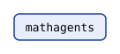
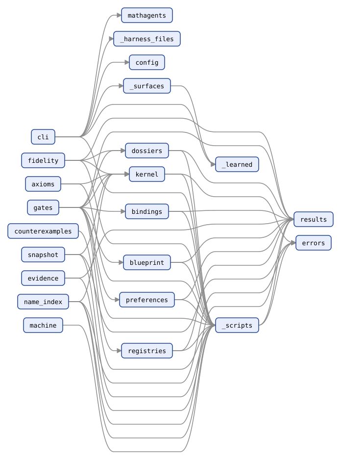
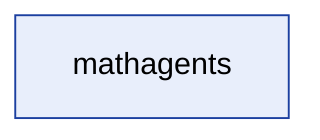

<!-- AGENTTEAMS:BEGIN content v=1 -->
# mathagents — Repository Architecture Map

> **Auto-generated.** Regenerated on every commit that touches the `mathagents` package. Do not edit manually — changes will be overwritten.

- Modules mapped: **23**
- Packages: **1**
- Internal import edges: **46**
- Distinct external dependencies: **1**

---

## Package Dependency Diagram

Inter-package import dependencies (module-level detail in the tables below).



---

## Packages

| Package | Modules | Depends on |
| --- | --- | --- |
| `mathagents` | 23 | — |

---

## Module Dependency Diagram

Every module, coloured by package (full adjacency in the table below).



---

## Module Dependency Table

| Module | Imports (internal) | Imported by |
| --- | --- | --- |
| `mathagents` | — | `mathagents.cli` |
| `mathagents._harness_files` | — | `mathagents.cli` |
| `mathagents._learned` | — | `mathagents._surfaces`, `mathagents.cli` |
| `mathagents._scripts` | `mathagents.errors`, `mathagents.results` | `mathagents.axioms`, `mathagents.bindings`, `mathagents.blueprint`, `mathagents.cli`, `mathagents.counterexamples`, `mathagents.dossiers`, `mathagents.evidence`, `mathagents.fidelity`, `mathagents.gates`, `mathagents.kernel`, `mathagents.machine`, `mathagents.name_index`, `mathagents.preferences`, `mathagents.registries`, `mathagents.snapshot` |
| `mathagents._surfaces` | `mathagents._learned` | `mathagents.cli` |
| `mathagents.axioms` | `mathagents._scripts`, `mathagents.kernel` | — |
| `mathagents.bindings` | `mathagents._scripts`, `mathagents.results` | `mathagents.gates` |
| `mathagents.blueprint` | `mathagents._scripts`, `mathagents.results` | `mathagents.gates` |
| `mathagents.cli` | `mathagents`, `mathagents._harness_files`, `mathagents._learned`, `mathagents._scripts`, `mathagents._surfaces`, `mathagents.config` | — |
| `mathagents.config` | — | `mathagents.cli` |
| `mathagents.counterexamples` | `mathagents._scripts` | — |
| `mathagents.dossiers` | `mathagents._scripts`, `mathagents.results` | `mathagents.fidelity`, `mathagents.gates` |
| `mathagents.errors` | — | `mathagents._scripts`, `mathagents.kernel`, `mathagents.name_index`, `mathagents.snapshot` |
| `mathagents.evidence` | `mathagents._scripts`, `mathagents.results` | — |
| `mathagents.fidelity` | `mathagents._scripts`, `mathagents.dossiers`, `mathagents.kernel`, `mathagents.results` | — |
| `mathagents.gates` | `mathagents._scripts`, `mathagents.bindings`, `mathagents.blueprint`, `mathagents.dossiers`, `mathagents.kernel`, `mathagents.preferences`, `mathagents.registries`, `mathagents.results` | — |
| `mathagents.kernel` | `mathagents._scripts`, `mathagents.errors` | `mathagents.axioms`, `mathagents.fidelity`, `mathagents.gates`, `mathagents.name_index`, `mathagents.snapshot` |
| `mathagents.machine` | `mathagents._scripts` | — |
| `mathagents.name_index` | `mathagents._scripts`, `mathagents.errors`, `mathagents.kernel`, `mathagents.results` | — |
| `mathagents.preferences` | `mathagents._scripts`, `mathagents.results` | `mathagents.gates` |
| `mathagents.registries` | `mathagents._scripts`, `mathagents.results` | `mathagents.gates` |
| `mathagents.results` | — | `mathagents._scripts`, `mathagents.bindings`, `mathagents.blueprint`, `mathagents.dossiers`, `mathagents.evidence`, `mathagents.fidelity`, `mathagents.gates`, `mathagents.name_index`, `mathagents.preferences`, `mathagents.registries` |
| `mathagents.snapshot` | `mathagents._scripts`, `mathagents.errors`, `mathagents.kernel` | — |

---

## External Dependencies

Third-party (non-stdlib) top-level packages imported by the mapped package:

`agentteams`

---

## Diagram Source

```dot
digraph "mathagents architecture" {
    rankdir=LR;
    node [fontname="Helvetica", fontsize=11, shape=box, style="rounded,filled", fillcolor="#eef6ee"];
    edge [fontsize=9];
    "mathagents" [fillcolor="#e8eefb"];
}
```

<details>
<summary>Mermaid &amp; DOT source for the diagram above</summary>





</details>

---

## JSON (module-level)

```json
{
  "root_package": "mathagents",
  "modules": {
    "mathagents": {
      "package": "mathagents",
      "path": "mathagents/__init__.py",
      "is_package": true,
      "imports_internal": [],
      "external": [],
      "repo_local": []
    },
    "mathagents._harness_files": {
      "package": "mathagents",
      "path": "mathagents/_harness_files.py",
      "is_package": false,
      "imports_internal": [],
      "external": [],
      "repo_local": []
    },
    "mathagents._learned": {
      "package": "mathagents",
      "path": "mathagents/_learned.py",
      "is_package": false,
      "imports_internal": [],
      "external": [],
      "repo_local": []
    },
    "mathagents._scripts": {
      "package": "mathagents",
      "path": "mathagents/_scripts.py",
      "is_package": false,
      "imports_internal": [
        "mathagents.errors",
        "mathagents.results"
      ],
      "external": [],
      "repo_local": []
    },
    "mathagents._surfaces": {
      "package": "mathagents",
      "path": "mathagents/_surfaces.py",
      "is_package": false,
      "imports_internal": [
        "mathagents._learned"
      ],
      "external": [
        "agentteams"
      ],
      "repo_local": []
    },
    "mathagents.axioms": {
      "package": "mathagents",
      "path": "mathagents/axioms.py",
      "is_package": false,
      "imports_internal": [
        "mathagents._scripts",
        "mathagents.kernel"
      ],
      "external": [],
      "repo_local": []
    },
    "mathagents.bindings": {
      "package": "mathagents",
      "path": "mathagents/bindings.py",
      "is_package": false,
      "imports_internal": [
        "mathagents._scripts",
        "mathagents.results"
      ],
      "external": [],
      "repo_local": []
    },
    "mathagents.blueprint": {
      "package": "mathagents",
      "path": "mathagents/blueprint.py",
      "is_package": false,
      "imports_internal": [
        "mathagents._scripts",
        "mathagents.results"
      ],
      "external": [],
      "repo_local": []
    },
    "mathagents.cli": {
      "package": "mathagents",
      "path": "mathagents/cli.py",
      "is_package": false,
      "imports_internal": [
        "mathagents",
        "mathagents._harness_files",
        "mathagents._learned",
        "mathagents._scripts",
        "mathagents._surfaces",
        "mathagents.config"
      ],
      "external": [],
      "repo_local": []
    },
    "mathagents.config": {
      "package": "mathagents",
      "path": "mathagents/config.py",
      "is_package": false,
      "imports_internal": [],
      "external": [],
      "repo_local": []
    },
    "mathagents.counterexamples": {
      "package": "mathagents",
      "path": "mathagents/counterexamples.py",
      "is_package": false,
      "imports_internal": [
        "mathagents._scripts"
      ],
      "external": [],
      "repo_local": []
    },
    "mathagents.dossiers": {
      "package": "mathagents",
      "path": "mathagents/dossiers.py",
      "is_package": false,
      "imports_internal": [
        "mathagents._scripts",
        "mathagents.results"
      ],
      "external": [],
      "repo_local": []
    },
    "mathagents.errors": {
      "package": "mathagents",
      "path": "mathagents/errors.py",
      "is_package": false,
      "imports_internal": [],
      "external": [],
      "repo_local": []
    },
    "mathagents.evidence": {
      "package": "mathagents",
      "path": "mathagents/evidence.py",
      "is_package": false,
      "imports_internal": [
        "mathagents._scripts",
        "mathagents.results"
      ],
      "external": [],
      "repo_local": []
    },
    "mathagents.fidelity": {
      "package": "mathagents",
      "path": "mathagents/fidelity.py",
      "is_package": false,
      "imports_internal": [
        "mathagents._scripts",
        "mathagents.dossiers",
        "mathagents.kernel",
        "mathagents.results"
      ],
      "external": [],
      "repo_local": []
    },
    "mathagents.gates": {
      "package": "mathagents",
      "path": "mathagents/gates.py",
      "is_package": false,
      "imports_internal": [
        "mathagents._scripts",
        "mathagents.bindings",
        "mathagents.blueprint",
        "mathagents.dossiers",
        "mathagents.kernel",
        "mathagents.preferences",
        "mathagents.registries",
        "mathagents.results"
      ],
      "external": [],
      "repo_local": []
    },
    "mathagents.kernel": {
      "package": "mathagents",
      "path": "mathagents/kernel.py",
      "is_package": false,
      "imports_internal": [
        "mathagents._scripts",
        "mathagents.errors"
      ],
      "external": [],
      "repo_local": []
    },
    "mathagents.machine": {
      "package": "mathagents",
      "path": "mathagents/machine.py",
      "is_package": false,
      "imports_internal": [
        "mathagents._scripts"
      ],
      "external": [],
      "repo_local": []
    },
    "mathagents.name_index": {
      "package": "mathagents",
      "path": "mathagents/name_index.py",
      "is_package": false,
      "imports_internal": [
        "mathagents._scripts",
        "mathagents.errors",
        "mathagents.kernel",
        "mathagents.results"
      ],
      "external": [],
      "repo_local": []
    },
    "mathagents.preferences": {
      "package": "mathagents",
      "path": "mathagents/preferences.py",
      "is_package": false,
      "imports_internal": [
        "mathagents._scripts",
        "mathagents.results"
      ],
      "external": [],
      "repo_local": []
    },
    "mathagents.registries": {
      "package": "mathagents",
      "path": "mathagents/registries.py",
      "is_package": false,
      "imports_internal": [
        "mathagents._scripts",
        "mathagents.results"
      ],
      "external": [],
      "repo_local": []
    },
    "mathagents.results": {
      "package": "mathagents",
      "path": "mathagents/results.py",
      "is_package": false,
      "imports_internal": [],
      "external": [],
      "repo_local": []
    },
    "mathagents.snapshot": {
      "package": "mathagents",
      "path": "mathagents/snapshot.py",
      "is_package": false,
      "imports_internal": [
        "mathagents._scripts",
        "mathagents.errors",
        "mathagents.kernel"
      ],
      "external": [],
      "repo_local": []
    }
  },
  "package_edges": [],
  "module_edges": [
    {
      "source": "mathagents._scripts",
      "target": "mathagents.errors"
    },
    {
      "source": "mathagents._scripts",
      "target": "mathagents.results"
    },
    {
      "source": "mathagents._surfaces",
      "target": "mathagents._learned"
    },
    {
      "source": "mathagents.axioms",
      "target": "mathagents._scripts"
    },
    {
      "source": "mathagents.axioms",
      "target": "mathagents.kernel"
    },
    {
      "source": "mathagents.bindings",
      "target": "mathagents._scripts"
    },
    {
      "source": "mathagents.bindings",
      "target": "mathagents.results"
    },
    {
      "source": "mathagents.blueprint",
      "target": "mathagents._scripts"
    },
    {
      "source": "mathagents.blueprint",
      "target": "mathagents.results"
    },
    {
      "source": "mathagents.cli",
      "target": "mathagents"
    },
    {
      "source": "mathagents.cli",
      "target": "mathagents._harness_files"
    },
    {
      "source": "mathagents.cli",
      "target": "mathagents._learned"
    },
    {
      "source": "mathagents.cli",
      "target": "mathagents._scripts"
    },
    {
      "source": "mathagents.cli",
      "target": "mathagents._surfaces"
    },
    {
      "source": "mathagents.cli",
      "target": "mathagents.config"
    },
    {
      "source": "mathagents.counterexamples",
      "target": "mathagents._scripts"
    },
    {
      "source": "mathagents.dossiers",
      "target": "mathagents._scripts"
    },
    {
      "source": "mathagents.dossiers",
      "target": "mathagents.results"
    },
    {
      "source": "mathagents.evidence",
      "target": "mathagents._scripts"
    },
    {
      "source": "mathagents.evidence",
      "target": "mathagents.results"
    },
    {
      "source": "mathagents.fidelity",
      "target": "mathagents._scripts"
    },
    {
      "source": "mathagents.fidelity",
      "target": "mathagents.dossiers"
    },
    {
      "source": "mathagents.fidelity",
      "target": "mathagents.kernel"
    },
    {
      "source": "mathagents.fidelity",
      "target": "mathagents.results"
    },
    {
      "source": "mathagents.gates",
      "target": "mathagents._scripts"
    },
    {
      "source": "mathagents.gates",
      "target": "mathagents.bindings"
    },
    {
      "source": "mathagents.gates",
      "target": "mathagents.blueprint"
    },
    {
      "source": "mathagents.gates",
      "target": "mathagents.dossiers"
    },
    {
      "source": "mathagents.gates",
      "target": "mathagents.kernel"
    },
    {
      "source": "mathagents.gates",
      "target": "mathagents.preferences"
    },
    {
      "source": "mathagents.gates",
      "target": "mathagents.registries"
    },
    {
      "source": "mathagents.gates",
      "target": "mathagents.results"
    },
    {
      "source": "mathagents.kernel",
      "target": "mathagents._scripts"
    },
    {
      "source": "mathagents.kernel",
      "target": "mathagents.errors"
    },
    {
      "source": "mathagents.machine",
      "target": "mathagents._scripts"
    },
    {
      "source": "mathagents.name_index",
      "target": "mathagents._scripts"
    },
    {
      "source": "mathagents.name_index",
      "target": "mathagents.errors"
    },
    {
      "source": "mathagents.name_index",
      "target": "mathagents.kernel"
    },
    {
      "source": "mathagents.name_index",
      "target": "mathagents.results"
    },
    {
      "source": "mathagents.preferences",
      "target": "mathagents._scripts"
    },
    {
      "source": "mathagents.preferences",
      "target": "mathagents.results"
    },
    {
      "source": "mathagents.registries",
      "target": "mathagents._scripts"
    },
    {
      "source": "mathagents.registries",
      "target": "mathagents.results"
    },
    {
      "source": "mathagents.snapshot",
      "target": "mathagents._scripts"
    },
    {
      "source": "mathagents.snapshot",
      "target": "mathagents.errors"
    },
    {
      "source": "mathagents.snapshot",
      "target": "mathagents.kernel"
    }
  ],
  "external_dependencies": [
    "agentteams"
  ],
  "repo_local_dependencies": []
}
```
<!-- AGENTTEAMS:END content -->
